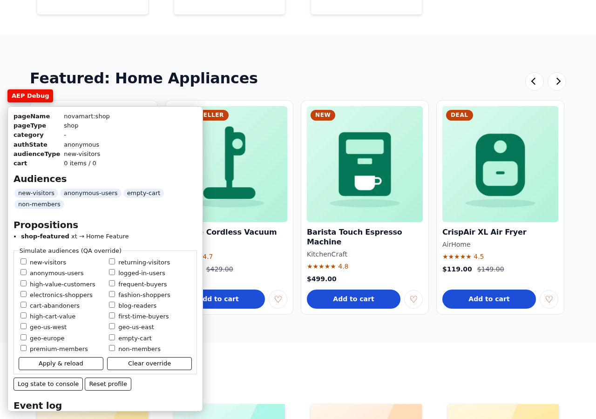
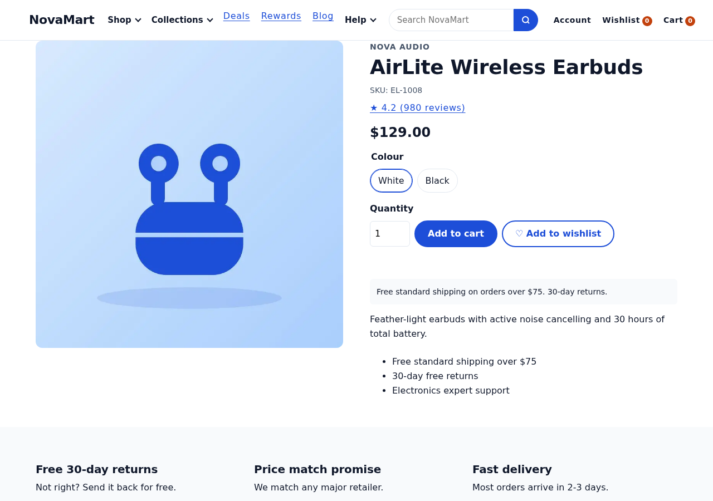
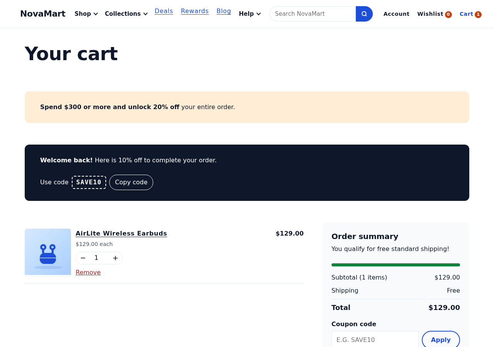
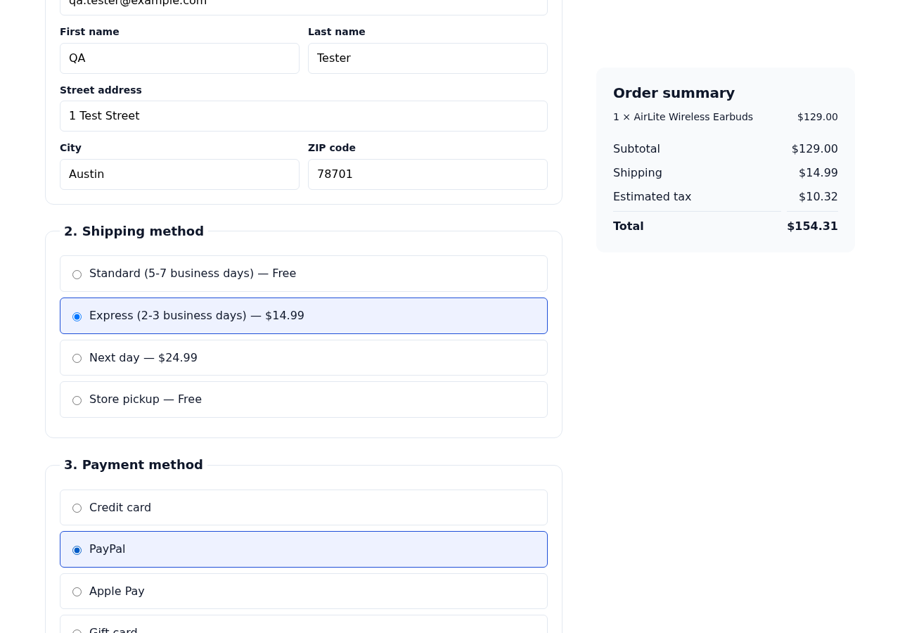

# Setting up Adobe Analytics for the NovaMart site: a step-by-step guide

This guide walks you through connecting the NovaMart training site
(`https://main--frescopa-eds-analytics--sravaneds.aem.page/`) to **Adobe Analytics**, using **Adobe Tags** (formerly Launch).
You don't need to write site code. Everything here happens in the Adobe Analytics admin screens and the Tags UI.
The only code is short snippets that you paste into Tags.

> **Before you dive in:** the website already does half the work. Every page and every click already pushes a
> message into a JavaScript object called the **data layer** (`window.adobeDataLayer`). Your job is to **listen to
> those messages in Tags** and turn them into Adobe Analytics hits.

---

## Contents

1. [How the pieces fit together](#1-how-the-pieces-fit-together)
2. [Words you need to know](#2-words-you-need-to-know)
3. [Before you start: access and known issues](#3-before-you-start-access-and-known-issues)
4. [Step 1: See the data layer for yourself](#step-1-see-the-data-layer-for-yourself)
5. [Step 2: Prepare the Adobe Analytics report suite](#step-2-prepare-the-adobe-analytics-report-suite)
6. [Step 3: Add the extensions in Tags](#step-3-add-the-extensions-in-tags)
7. [Step 4: Create the data elements](#step-4-create-the-data-elements)
8. [Step 5: Create the rules](#step-5-create-the-rules)
9. [Step 6: Publish and test](#step-6-publish-and-test)
10. [Step 7: Check the data in Analytics](#step-7-check-the-data-in-analytics)
11. [Troubleshooting](#troubleshooting)
12. [Checklist](#checklist)

---

## 1. How the pieces fit together

```
  Visitor's browser
  ┌───────────────────────────────────────────────────────────────────────────┐
  │  NovaMart page (Edge Delivery Services)                                   │
  │     │  every page view, click, add to cart … pushes a message:            │
  │     │     adobeDataLayer.push({ event: 'cartAdd', eventInfo: {...} })      │
  │     ▼                                                                     │
  │  window.adobeDataLayer  (Adobe Client Data Layer)                         │
  │     │  Tags listens ("Data Pushed: cartAdd")                              │
  │     ▼                                                                     │
  │  Adobe Tags rule  ──►  sets Analytics variables  ──►  sends a hit         │
  └───────────────────────────────────────────────────────────────────────────┘
                                                             │
                                                             ▼
                                            Adobe Analytics report suite
                                         (tcsdmprtnrsndbxtcstraining-dev)
```

**Already done for you:**
- The site loads your Tags library. `head.html` contains
  `launch-02d7da8bdc69-development.min.js` (property "Adobe Training Website").
- The Tags library already has the **Adobe Analytics** extension, set to report suite `tcsdmprtnrsndbxtcstraining-dev`.
- The site pushes about 60 different events into the data layer.

**Missing (you'll build it in this guide):**
- The library has **no rules and no data elements**, so **no Analytics hits are sent yet**.

---

## 2. Words you need to know

| Word | Plain meaning | Example on this site |
| --- | --- | --- |
| **Data layer** | A JavaScript object the site fills with facts about the page and the visitor's actions | `window.adobeDataLayer` |
| **Event (data layer)** | A message pushed when something happens | `{ event: 'cartAdd', eventInfo: { productId: 'EL-1008', quantity: 1 } }` |
| **State** | Everything pushed so far, merged into one object | `adobeDataLayer.getState('page.pageName')` → `novamart:shop` |
| **Tags property** | Your container of extensions, data elements and rules | "Adobe Training Website" |
| **Extension** | A plug-in inside Tags | Adobe Analytics, Adobe Client Data Layer |
| **Data element** | A named shortcut to one value | `DL - Page Name` → `novamart:shop` |
| **Rule** | "When **this** happens, do **that**" | When `cartAdd` is pushed, send an Analytics hit with `scAdd` |
| **Hit / beacon** | One request sent to Adobe Analytics | `…/b/ss/tcsdmprtnrsndbxtcstraining-dev/…` |
| **s.t()** | A **page view** hit | Every page load |
| **s.tl()** | A **link / action** hit (not counted as a page view) | Add to cart, filter, click |
| **eVar** | A dimension that *remembers* its value for a while | eVar40 = search term |
| **prop** | A dimension for one hit only | prop1 = page type |
| **Success event** | A counter (metric) | `scAdd` = cart additions, `event20` = searches |
| **s.products** | A special string listing products: `;SKU;quantity;price;events;eVars` | `;EL-1008;1;129.00` |
| **Report suite** | The database in Analytics that receives the hits | `tcsdmprtnrsndbxtcstraining-dev` |

---

## 3. Before you start: access and known issues

### Access you need

| Need | Where | Who grants it |
| --- | --- | --- |
| Edit the Tags property "Adobe Training Website" (develop + publish to Development) | Experience Platform → **Data Collection → Tags** | Tags admin |
| Admin rights on report suite `tcsdmprtnrsndbxtcstraining-dev` | Adobe Analytics → **Admin → Report Suites** | Analytics admin |
| The **tracking server** value for your company (e.g. `xxxxx.sc.omtrdc.net`) | Analytics admin / Adobe support | Analytics admin |
| Chrome extension **Adobe Experience Platform Debugger** | Chrome Web Store | — |

### Known issues: read these first

These come from the [readiness assessment](../docs/analytics-assessment/README.md). They don't stop you
practising, but you should know about them.

| Issue | What it means for you | Workaround in this guide |
| --- | --- | --- |
| **No cookie or consent banner** | Analytics will run for every visitor | OK for a training sandbox. **Not OK for real visitors**: get privacy sign-off first |
| **Two page-view messages** per page (`page-view` from the commerce code and `pageView` from the training code) | Listening to both would count every page twice | Listen **only to `pageView`** (camelCase) |
| **Prerendering**: Chrome may load a page when you hover a link | A page view can be sent for a page the visitor never opened | Accept for training. The real fix is a code change (assessment, section 7, F4) |
| **The grid's search box fires a search after every typing pause** | Partial words ("hea", "headph") would count as searches | Count searches only from the **Search block** (condition in Rule 12) |
| **Signed-in header link says "Hi, Alex"** | That first name would become a "link name" | Turn **Activity Map off** (Step 3) and don't send `CTAName` for header clicks |
| **Development library is used on every environment** | Preview and live both send to the dev report suite | Fine for training; ask for separate libraries before go-live |
| **Only 4 pages are published live**, and some products aren't previewed | Some links lead to 404 during testing | Test on the pages in [Step 6](#step-6-publish-and-test) |

---

## Step 1: See the data layer for yourself

Do this first. Once you've seen the data layer, the rest of the guide is easier to follow.

1. Open **https://main--frescopa-eds-analytics--sravaneds.aem.page/shop?aep-debug=1**
2. Click the red **AEP Debug** button (bottom left). It shows the page name, page type, your audiences and an event log.

   

3. Open Chrome DevTools (**F12**) → **Console** and type:

   ```js
   adobeDataLayer.getState()
   ```

   You will see objects like these:

   ```json
   {
     "page": { "pageName": "novamart:shop", "pageType": "shop", "siteSection": "shop", "language": "en", "environment": "preview" },
     "user": { "authState": "anonymous", "visitorType": "new", "audienceType": "new-visitors" },
     "cart": { "cartId": "", "itemCount": 0, "subtotal": 0 },
     "campaign": { "campaignId": "", "source": "", "medium": "" },
     "personalization": { "personalizationVariant": "XT-SHOP-FEATURED:Home Feature" }
   }
   ```

4. Now type this to watch every message as it arrives:

   ```js
   adobeDataLayer.addEventListener('adobeDataLayer:event', (e) => console.log(e.event, e.eventInfo));
   ```

   Scroll the page, click **Add to cart** on a product, and watch messages like `scrollDepth` and `cartAdd` appear.

**What you learned:** each message has a name (`event`) and details (`eventInfo`). In Tags, a rule listens for a
name and reads the details.

### The messages you'll use

| Message (`event`) | When it is pushed | Useful details in `eventInfo` |
| --- | --- | --- |
| `pageView` | Every page load | `pageType`, `category`, `audienceType`, `personalizationVariant` |
| `productListImpression` | A product grid or carousel becomes half visible | `listName`, `productIds` (comma-separated), `resultCount` |
| `productClick` / `productCarouselClick` / `recommendationClick` | A product card is clicked | `productId`, `productName`, `category`, `price`, `listName`, `position` |
| `productView` | Product detail page shown | `productId`, `productName`, `brand`, `category`, `price` |
| `cartOpen` | First item added to an empty cart | `cartId` |
| `cartAdd` | Add to cart (or quantity +) | `productId`, `productName`, `price`, `quantity`, `source` |
| `cartRemove` | Remove (or quantity −) | `productId`, `productName`, `price`, `quantity`, `source` |
| `cartView` | Cart page shown | `cartId`, `itemCount`, `cartSubtotal` |
| `checkoutStart` | Checkout shown with items | `cartId`, `itemCount`, `cartTotal`, `products[]` |
| `checkoutStep` | First use of each checkout step | `checkoutStep`, `checkoutStepNumber` |
| `shippingSelect` / `paymentSelect` | Shipping or payment option chosen | `shippingMethod` / `paymentMethod` |
| `checkoutComplete` | Order placed | `orderId`, `revenue`, `tax`, `shipping`, `couponCode`, `products[]` |
| `searchSubmit` / `searchNoResults` | A search ran | `SearchTerm`, `searchType`, `resultCount`, `component` |
| `filterApply` / `sortApply` | Filter or sort changed in the product grid | `filterType`, `filterValue`, `resultCount` |
| `bannerImpression` / `bannerClick` | Promo banner seen / clicked | `campaignId`, `bannerName` |
| `heroClick`, `ctaClick` | Hero / call-to-action clicked | `CTAName`, `campaignId` |

---

## Step 2: Prepare the Adobe Analytics report suite

In **Adobe Analytics → Admin → Report Suites**, select `tcsdmprtnrsndbxtcstraining-dev`, then **Edit Settings**.

### 2a. Turn on the commerce events

**Edit Settings → Conversion → Conversion Level → Enabled**. This makes `prodView`, `scOpen`, `scAdd`,
`scRemove`, `scView`, `scCheckout` and `purchase` available.

### 2b. Create the custom variables

These numbers follow the site's tracking matrix (`docs/aep-training/04-analytics-tracking-matrix.md`). If your
report suite already uses some of them, pick free numbers and **use your numbers everywhere below**.

**Conversion variables (eVars)**: *Edit Settings → Conversion → Conversion Variables → Add New*

| eVar | Name | Expire after | Allocation |
| --- | --- | --- | --- |
| eVar1 | Page Name | Hit | Most recent |
| eVar2 | Page Type | Hit | Most recent |
| eVar3 | Category | Visit | Most recent |
| eVar5 | Internal Campaign ID | Visit | Most recent |
| eVar12 | Product List Name *(merchandising, product syntax, bind on prodView, scAdd)* | Purchase | Most recent |
| eVar13 | Product List Position *(merchandising, product syntax)* | Purchase | Most recent |
| eVar14 | Cart Add Source *(merchandising, product syntax)* | Purchase | Most recent |
| eVar20 | Audience Type | Visit | Most recent |
| eVar21 | Personalization Variant | Visit | Most recent |
| eVar30 | CTA Name | Hit | Most recent |
| eVar40 | Search Term | Visit | Most recent |
| eVar43 | Search Type | Hit | Most recent |
| eVar45 | Checkout Step | Hit | Most recent |
| eVar46 | Shipping Method | Purchase | Most recent |
| eVar47 | Payment Method | Purchase | Most recent |

**Traffic variables (props)**: *Edit Settings → Traffic → Traffic Variables*

| prop | Name |
| --- | --- |
| prop1 | Page Type |
| prop3 | Category |
| prop40 | Search Term |
| prop41 | Search Result Count |

**Success events**: *Edit Settings → Conversion → Success Events*

| Event | Name | Type |
| --- | --- | --- |
| event10 | Scroll Milestone | Counter |
| event13 | Promo Impression | Counter |
| event14 | Promo Click | Counter |
| event20 | Searches | Counter |
| event21 | Product List Views | Counter |
| event22 | Product Clicks | Counter |
| event24 | Filter Applied | Counter |
| event25 | Sort Changed | Counter |
| event27 | Null Searches | Counter |
| event45 | Checkout Step | Counter |

> **Why "merchandising" eVars?** eVar12–14 describe a *product* (which list it came from, its position, how it was
> added). Product-syntax merchandising keeps that value attached to that product until purchase, so you can report
> "revenue by product list".

---

## Step 3: Add the extensions in Tags

Open **Data Collection → Tags → Adobe Training Website**, then **Extensions**.

### 3a. Adobe Client Data Layer (install)

1. **Extensions → Catalog**, search **Adobe Client Data Layer**, then **Install**.
2. **Data Layer object name:** `adobeDataLayer`. The name must match exactly.
3. Save.

> The site already loads the data-layer library itself. If the console shows *"Adobe Client Data Layer … has already
> been imported"*, it's only a warning: both copies share the same `adobeDataLayer` array.

### 3b. Experience Cloud ID Service (install)

1. **Catalog → Experience Cloud ID Service → Install.**
2. **Experience Cloud Organization ID:** `711081AF6A6928B90A495E2E@AdobeOrg`. This is the org ID already in your Analytics extension.
3. Save.

This gives each visitor a stable Experience Cloud ID (ECID). Analytics uses it to recognise returning visitors.

### 3c. Adobe Analytics (already installed: check the settings)

**Extensions → Installed → Adobe Analytics → Configure**

| Setting | Value |
| --- | --- |
| Report suites (Development / Staging / Production) | `tcsdmprtnrsndbxtcstraining-dev` (already set) |
| **General → Tracking Server** | Your company's tracking server (from your Analytics admin) |
| **General → Currency Code** | `USD` (already set) |
| **Link Tracking → Enable Activity Map** | **Off** (see known issues: it would capture link text such as "Hi, Alex") |
| **Global Variables → Page Name** | leave empty; Rule 1 sets it |

Save.

---

## Step 4: Create the data elements

A **data element** is a named shortcut to one value. **Data Elements → Add Data Element** for each row:

| Name | Extension | Data Element Type | Path |
| --- | --- | --- | --- |
| `DL - Page Name` | Adobe Client Data Layer | Data Layer Computed State | `page.pageName` |
| `DL - Page Type` | Adobe Client Data Layer | Data Layer Computed State | `page.pageType` |
| `DL - Site Section` | Adobe Client Data Layer | Data Layer Computed State | `page.siteSection` |
| `DL - Category` | Adobe Client Data Layer | Data Layer Computed State | `page.category` |
| `DL - Language` | Adobe Client Data Layer | Data Layer Computed State | `page.language` |
| `DL - Campaign ID` | Adobe Client Data Layer | Data Layer Computed State | `campaign.campaignId` |
| `DL - Audience Type` | Adobe Client Data Layer | Data Layer Computed State | `user.audienceType` |
| `DL - Personalization Variant` | Adobe Client Data Layer | Data Layer Computed State | `personalization.personalizationVariant` |
| `DL - Cart ID` | Adobe Client Data Layer | Data Layer Computed State | `cart.cartId` |

Leave **Default value** empty and **Force lowercase** off.

> **Event details don't need data elements.** Inside a rule you can read the pushed message directly with
> `%event.message.eventInfo.productId%` (in Set Variables fields), or with `event.message.eventInfo.productId`
> in custom code.

---

## Step 5: Create the rules

Every rule has the same pattern:

```
EVENT       Adobe Client Data Layer → Data Pushed → Listen to: Specific event → <message name>
ACTIONS     1. Adobe Analytics → Set Variables   (fill fields and/or custom code)
            2. Adobe Analytics → Send Beacon     (s.t() for page views, s.tl() for everything else)
            3. Adobe Analytics → Clear Variables (so values don't leak into the next hit)
```

To create one: **Rules → Add Rule**, give it a name, add the **Event**, then add the three **Actions** in order.

> **Tip for custom code in Set Variables:** variables set in custom code for an `s.tl()` hit must be listed in
> `s.linkTrackVars` and `s.linkTrackEvents`, otherwise they're not sent. The snippets below do this for you.

### Rule 1: Page view
- **Event:** Data Pushed → Specific event → `pageView` (camelCase. **Not** `page-view`)
- **Set Variables:**

| Field | Value |
| --- | --- |
| Page Name | `%DL - Page Name%` |
| Channel | `%DL - Site Section%` |
| Campaign | `%DL - Campaign ID%` (only if marketing agrees `cid`/`utm_campaign` = tracking code) |
| eVar1 | `D=pageName` |
| eVar2 / prop1 | `%DL - Page Type%` |
| eVar3 / prop3 | `%DL - Category%` |
| eVar20 | `%DL - Audience Type%` |
| eVar21 | `%DL - Personalization Variant%` |

- **Send Beacon:** `s.t()` (page view)
- **Clear Variables**

### Rule 2: Product list view
- **Event:** Data Pushed → `productListImpression`
- **Set Variables → custom code:**

```js
var info = event.message.eventInfo;
var ids = String(info.productIds || '').split(',').filter(Boolean);
s.products = ids.map(function (id, i) { return ';' + id + ';;;;eVar12=' + info.listName + '|eVar13=' + (i + 1); }).join(',');
s.events = 'event21';
s.linkTrackVars = 'products,events';
s.linkTrackEvents = 'event21';
```

- **Send Beacon:** `s.tl()`, link type **Other**, link name `product list view`
- **Clear Variables**

### Rule 3: Product click (product select)
- **Event:** Data Pushed → `productClick`. Add two more events in the same rule: `productCarouselClick` and `recommendationClick`.
- **Set Variables → custom code:**

```js
var info = event.message.eventInfo;
s.products = ';' + info.productId + ';;;;eVar12=' + info.listName + '|eVar13=' + info.position;
s.events = 'event22';
s.useBeacon = true; // the browser leaves the page right after the click
s.linkTrackVars = 'products,events';
s.linkTrackEvents = 'event22';
```

- **Send Beacon:** `s.tl()`, **Other**, link name `product click`
- **Clear Variables**

### Rule 4: Product view
- **Event:** Data Pushed → `productView`
- **Set Variables → custom code:**

```js
var info = event.message.eventInfo;
s.products = ';' + info.productId;
s.events = 'prodView';
s.linkTrackVars = 'products,events';
s.linkTrackEvents = 'prodView';
```

- **Send Beacon:** `s.tl()`, **Other**, `product view`

> The page view is already sent by Rule 1 for the same page, so `prodView` is sent as its own link hit.

- **Clear Variables**

### Rule 5: Cart open
- **Event:** Data Pushed → `cartOpen`
- **Set Variables → custom code:** `s.events = 'scOpen'; s.linkTrackVars = 'events'; s.linkTrackEvents = 'scOpen';`
- **Send Beacon:** `s.tl()`, **Other**, `cart open` · **Clear Variables**

### Rule 6: Add to cart
- **Event:** Data Pushed → `cartAdd`
- **Set Variables → custom code:**

```js
var info = event.message.eventInfo;
s.products = ';' + info.productId + ';' + info.quantity + ';;;eVar14=' + info.source;
s.events = 'scAdd';
s.linkTrackVars = 'products,events';
s.linkTrackEvents = 'scAdd';
```

- **Send Beacon:** `s.tl()`, **Other**, `add to cart` · **Clear Variables**

### Rule 7: Remove from cart
- **Event:** Data Pushed → `cartRemove`
- **Set Variables → custom code:**

```js
var info = event.message.eventInfo;
s.products = ';' + info.productId + ';' + info.quantity;
s.events = 'scRemove';
s.linkTrackVars = 'products,events';
s.linkTrackEvents = 'scRemove';
```

- **Send Beacon:** `s.tl()`, **Other**, `remove from cart` · **Clear Variables**

### Rule 8: Cart view
- **Event:** Data Pushed → `cartView`
- **Condition (optional):** Core → Value Comparison → `%event.message.eventInfo.itemCount%` *is greater than* `0`
  (only if the business decides empty carts should not count)
- **Set Variables → custom code:** `s.events = 'scView'; s.linkTrackVars = 'events'; s.linkTrackEvents = 'scView';`
- **Send Beacon:** `s.tl()`, **Other**, `cart view` · **Clear Variables**

### Rule 9: Checkout start
- **Event:** Data Pushed → `checkoutStart`
- **Set Variables → custom code:**

```js
var info = event.message.eventInfo;
s.products = (info.products || []).map(function (p) { return ';' + p.productId + ';' + p.quantity; }).join(',');
s.events = 'scCheckout';
s.linkTrackVars = 'products,events';
s.linkTrackEvents = 'scCheckout';
```

- **Send Beacon:** `s.tl()`, **Other**, `checkout start` · **Clear Variables**

> Refreshing the checkout page sends this again. That's a known limitation until the code de-duplicates it.

### Rule 10: Checkout step, shipping and payment
- **Event:** Data Pushed → `checkoutStep`, plus `shippingSelect` and `paymentSelect` in the same rule
- **Set Variables → custom code:**

```js
var info = event.message.eventInfo;
s.eVar45 = info.checkoutStep || (info.shippingMethod ? 'shipping-method' : 'payment');
if (info.shippingMethod) s.eVar46 = info.shippingMethod;
if (info.paymentMethod) s.eVar47 = info.paymentMethod;
s.events = 'event45';
s.linkTrackVars = 'eVar45,eVar46,eVar47,events';
s.linkTrackEvents = 'event45';
```

- **Send Beacon:** `s.tl()`, **Other**, `checkout step` · **Clear Variables**

### Rule 11: Purchase
- **Event:** Data Pushed → `checkoutComplete`
- **Set Variables → custom code:**

```js
var info = event.message.eventInfo;
s.purchaseID = info.orderId;                     // stops the same order being counted twice
s.products = (info.products || []).map(function (p) {
  return ';' + p.productId + ';' + p.quantity + ';' + (p.price * p.quantity).toFixed(2); // product revenue
}).join(',');
s.events = 'purchase';
s.eVar46 = info.shippingMethod;
s.eVar47 = info.paymentMethod;
s.useBeacon = true;                              // the page redirects to the confirmation page
s.linkTrackVars = 'products,events,purchaseID,eVar46,eVar47';
s.linkTrackEvents = 'purchase';
```

- **Send Beacon:** `s.tl()`, **Other**, `purchase` · **Clear Variables**

> **Revenue:** this counts **product revenue** (price × quantity), the usual Analytics convention. The site's
> `revenue` value also includes tax and shipping. Ask the business which one they want.
>
> **Order IDs** are random 6-digit numbers on this demo store, so two test orders could share an ID and one would be ignored.

### Rule 12: Search results
- **Events:** Data Pushed → `searchSubmit`, plus `searchNoResults` in the same rule
- **Condition:** Core → Value Comparison → `%event.message.eventInfo.component%` *equals* `search`
  (only the Search block counts, see known issues)
- **Set Variables → custom code:**

```js
var info = event.message.eventInfo;
var term = String(info.SearchTerm || '').trim().toLowerCase()
  .replace(/[^\s@]+@[^\s@]+\.[^\s@]+/g, '[email]');   // never send an email address someone typed
s.eVar40 = term;
s.prop40 = 'D=v40';
s.eVar43 = info.searchType;
// -1 means "not known yet": the Shop search box sends you to the product listing to show results
s.prop41 = info.resultCount >= 0 ? String(info.resultCount) : 'unknown';
s.events = info.resultCount === 0 ? 'event20,event27' : 'event20';
s.linkTrackVars = 'eVar40,prop40,eVar43,prop41,events';
s.linkTrackEvents = 'event20,event27';
```

- **Send Beacon:** `s.tl()`, **Other**, `search` · **Clear Variables**

### Rule 13: Filter and sort
- **Events:** Data Pushed → `filterApply`, plus `sortApply` in the same rule
- **Set Variables → custom code:**

```js
var info = event.message.eventInfo;
var isSort = event.message.event === 'sortApply';
s.events = isSort ? 'event25' : 'event24';
s.linkTrackVars = 'events';
s.linkTrackEvents = s.events;
```

- **Send Beacon:** `s.tl()`, **Other**, link name `%event.message.eventInfo.filterType%:%event.message.eventInfo.filterValue%`
- **Clear Variables**

### Rule 14: Promo impression and promo click
- **Events:** Data Pushed → `bannerImpression`, `bannerClick` and `heroClick` in the same rule
- **Set Variables → custom code:**

```js
var info = event.message.eventInfo;
var isImpression = event.message.event === 'bannerImpression';
s.eVar5 = info.campaignId || info.bannerName || 'unknown-promo';
s.events = isImpression ? 'event13' : 'event14';
if (!isImpression) s.useBeacon = true;
s.linkTrackVars = 'eVar5,events';
s.linkTrackEvents = s.events;
```

- **Send Beacon:** `s.tl()`, **Other**, link name `promo`
- **Clear Variables**

> Banners on this site carry a **campaign ID** (for example `CMP-FLASH-A`). The hero has none yet, so its clicks fall
> back to `unknown-promo` until marketing defines promo IDs.

### Rule 15 (optional): Scroll depth
- **Event:** Data Pushed → `scrollDepth`
- **Condition:** `%event.message.eventInfo.scrollDepth%` *equals* `75` (one milestone keeps hit volume low)
- **Set Variables:** `s.events = 'event10'` (custom code with `linkTrackVars/Events`) · **Send Beacon** `s.tl()` · **Clear Variables**

### Not possible yet
| Wanted | Why not |
| --- | --- |
| Newsletter sign-up | The site has no newsletter form. The blog "Subscribe" button only links to the Rewards page |
| Consent-based tracking | The site has no cookie / consent banner |

---

## Step 6: Publish and test

### 6a. Build the library
1. **Publishing Flow → Add Library** (or open your existing development library).
2. Name it `analytics setup`, environment **Development**.
3. **Add All Changed Resources**, then **Save & Build to Development**.
4. Wait for the green dot. The site picks up the development library automatically, because `head.html` already
   points to it.

### 6b. Test with the Experience Platform Debugger

Open each page, open the **Debugger** extension, then **Analytics**. Tick **Preserve log** so hits survive page
changes.

| # | Do this | Expect in Debugger → Analytics |
| --- | --- | --- |
| 1 | Open `/shop` | **1** page-view hit: `pageName = novamart:shop`, `eVar2 = shop`, `eVar21` = a `XT-SHOP-FEATURED:…` value |
| 2 | Scroll until the product carousel is half visible | 1 link hit, `event21`, `products` lists 8 products with `eVar12`/`eVar13` |
| 3 | Open `/products/airlite-wireless-earbuds` | Page view + 1 link hit `prodView;EL-1008` |
| 4 | Click **Add to cart** | `scOpen` (first time) and `scAdd` with `;EL-1008;1;;;eVar14=pdp` |
| 5 | Open `/products?q=earbuds`, change **Brand** | `event24` |
| 6 | Change **Sort by** | `event25` |
| 7 | On `/shop`, use the **"What are you looking for?"** search with `headphones` | `event20`, `eVar40 = headphones` |
| 8 | Open `/cart`, click **−** on an item | `scView`, then `scRemove` |
| 9 | Go to `/checkout`, choose **Express** and **PayPal** | `scCheckout`, then `event45` hits with `eVar46 = express`, `eVar47 = paypal` |
| 10 | Fill the form and **Place order** | `purchase` with `purchaseID = NM-…` and product revenue |
| 11 | Refresh the confirmation page | **No** second purchase |
| 12 | Check every hit | No email addresses or personal names anywhere |

Screens you will pass through:

| Product page | Cart | Checkout |
| --- | --- | --- |
|  |  |  |

---

## Step 7: Check the data in Analytics

1. **Analysis Workspace → Real-time** (if enabled for the report suite), or wait 30–90 minutes for standard processing.
2. Build a quick freeform table:
   - **Dimension:** Page Name → **Metric:** Page Views (you should see `novamart:shop`, `novamart:products:…`)
   - **Dimension:** Products → **Metrics:** Product Views, Cart Additions, Checkouts, Orders, Revenue
   - **Dimension:** Product List Name (eVar12) → **Metrics:** Product Clicks (event22), Cart Additions
   - **Dimension:** Search Term (eVar40) → **Metrics:** Searches (event20), Null Searches (event27)
3. Create a **Fallout** visualisation: Page View → Product View → Cart Addition → Checkout → Order.

---

## Troubleshooting

| Symptom | Likely cause | Fix |
| --- | --- | --- |
| No hits at all | Library not built, or an old library is cached | Rebuild to Development; hard-refresh (Ctrl+Shift+R) |
| `_satellite` is undefined in the console | Tags script failed to load | Check the Network tab for `launch-02d7da8bdc69-development.min.js` |
| Rules never fire | Wrong message name (case-sensitive) or ACDL object name not `adobeDataLayer` | Compare with `adobeDataLayer.getState()` / the event log; run `_satellite.setDebug(true)` and reload |
| Two page views per page | A rule listens to `page-view` as well as `pageView` | Use only `pageView` |
| Variables missing on link hits | Not listed in `s.linkTrackVars` / `s.linkTrackEvents` | Add them in the custom code |
| Product click or purchase hit missing | Page navigated before the hit was sent | Keep `s.useBeacon = true` in those rules |
| Many searches for one search | Grid search box fires per pause | Keep the condition `component equals search` |
| Hits go to the wrong report suite | Extension report-suite setting | Adobe Analytics extension → Report Suites |

---

## Checklist

- [ ] Step 1: Looked at `adobeDataLayer.getState()` and the event log
- [ ] Step 2: Conversion level on; eVars, props and events created in the report suite
- [ ] Step 3: Adobe Client Data Layer and ECID extensions installed; tracking server set; Activity Map off
- [ ] Step 4: Nine `DL - …` data elements created
- [ ] Step 5: Rules 1–14 created (15 optional)
- [ ] Step 6: Library built to Development; all 12 tests passed
- [ ] Step 7: Data visible in Workspace
- [ ] Before real visitors: consent banner, privacy sign-off, separate production library and report suite
  (see the [readiness assessment](../docs/analytics-assessment/README.md), sections 5 and 12)
