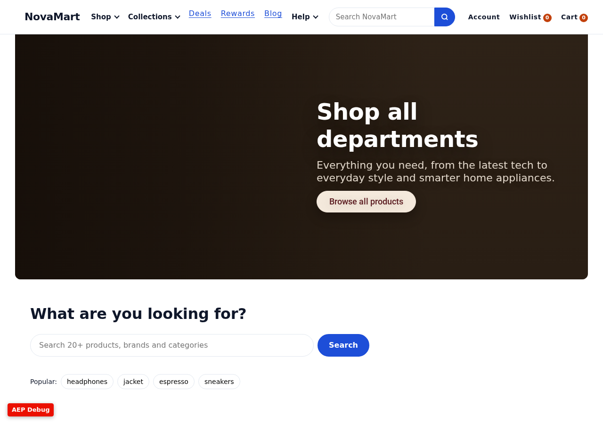
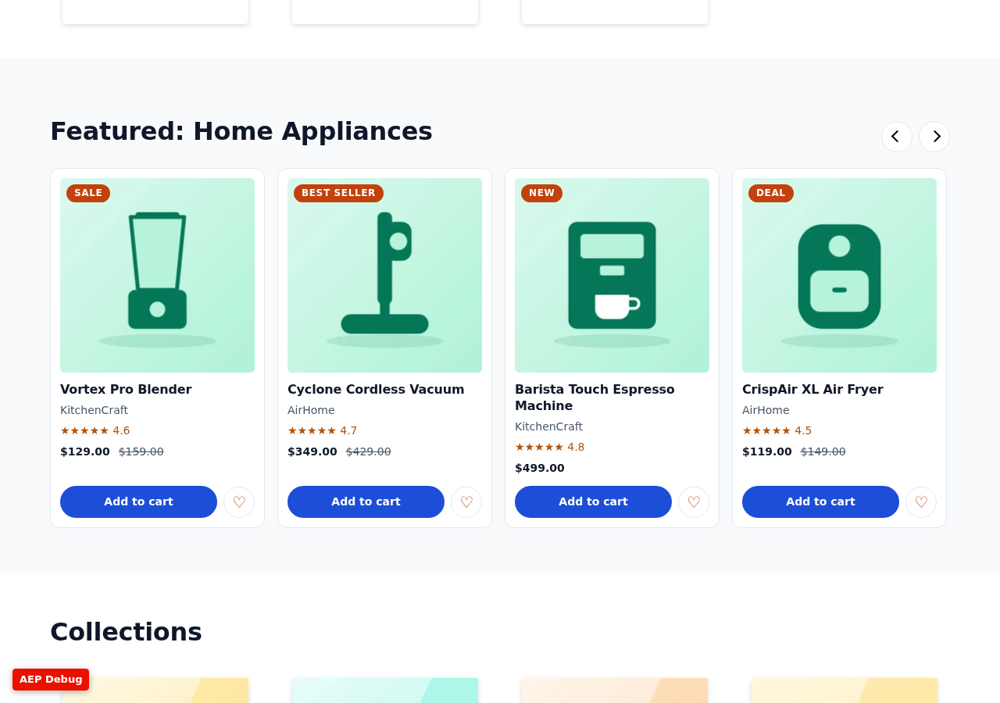
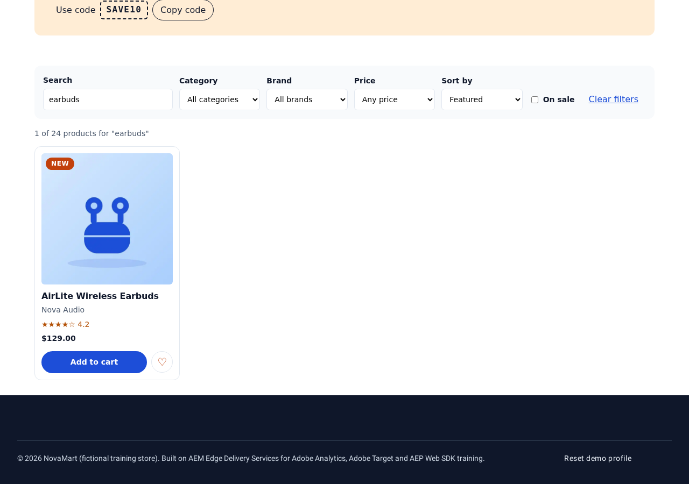
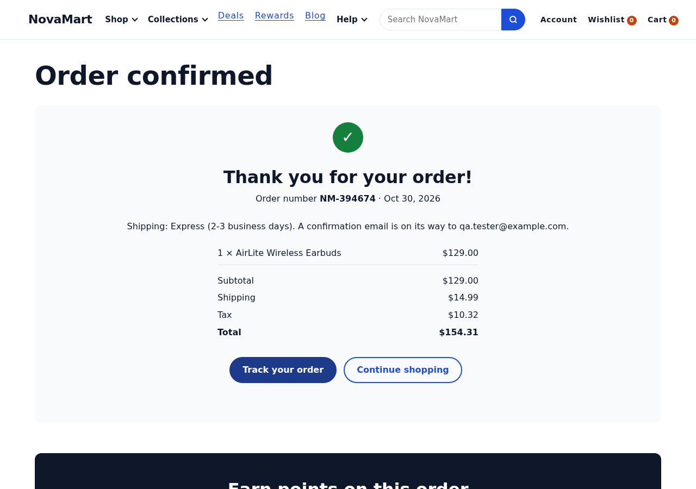

# Adobe Analytics Implementation Readiness Assessment

**Site:** https://main--frescopa-eds-analytics--sravaneds.aem.page/shop
**Repository:** `sravaneds/frescopa-eds-analytics`, branch `main`, commit `0d6dae4`
**Assessed:** 30 October 2026 · **Type:** read-only assessment (no project files changed)

---

## 0. Executive summary

1. **The Shop page is the NovaMart training site, not the Frescopa Adobe Commerce storefront.** `/shop` uses the `aep-training` template. Products are authored as block rows in AEM; nothing is read from Adobe Commerce. The Frescopa drop-in blocks (`product-details`, `product-list-page`, `commerce-cart`, `commerce-checkout`, recommendations) are in the repository but **not used on any training page**. Their initializers still run on every page.
2. **A rich client-side data layer exists.** The Adobe Client Data Layer (ACDL) state has `page`, `user`, `product`, `cart`, `campaign` and `personalization` objects, and about 60 interaction events are pushed. It is not yet in a standard semantic format (`add_to_cart`, `purchase`…), and two other data models are pushed in parallel: the commerce boilerplate's `pageContext` / `page-view` and the Commerce collector contexts.
3. **Adobe Tags loads, but sends nothing.** The development library (`launch-02d7da8bdc69-development.min.js`, property "Adobe Training Website", built 2026-10-29) contains the Core and Adobe Analytics extensions only. It has **no rules, no data elements, no Experience Cloud ID Service and no Web SDK**, so **no Adobe Analytics hits are sent today**.
4. **Blockers before go-live:**
   - **No consent management.** `getConsent()` is a stub that always returns `true`.
   - **Analytics runs inside prerendered pages.** Speculation rules prerender links on hover, and the page-view and product-view logic does not wait for activation.
   - **Commerce is a client-side demo.** Cart, checkout and order are simulated in `localStorage`: random order IDs, no payment, no backend.
   - **PII exposure.** The shopper's email address is stored in `localStorage` and shown on the confirmation page, and the first name appears in a tracked link label.
5. **Most commerce events already have a source.** The grid, carousel, PDP, cart, checkout and confirmation blocks already emit an event at the right moment. The main work is a **semantic event adapter** with deduplication, plus prerender and consent gating, Tags rules, and the business decisions listed in section 6.

| Status | Count of assessed requirements (section 3) |
| --- | --- |
| Ready | 2 |
| Partially ready | 13 |
| Missing | 7 |
| Blocked by business input | 3 |
| Blocked by unavailable checkout or order functionality | 3 |

---

## 1. Scope, method and evidence

| Item | Detail |
| --- | --- |
| Code inspected | `head.html`, `scripts/scripts.js`, `scripts/delayed.js`, `scripts/commerce.js`, `scripts/initializers/*`, `scripts/commerce-events-*.js`, `scripts/aep/*`, `blocks/{product-grid,product-carousel,product-info,cart,checkout,orders,search,banner,header,cta,cards,hero,faq,tabs}`, `config.json`, `helix-query.yaml` |
| Live pages fetched | `/shop`, `/products`, `/products/airlite-wireless-earbuds`, `/cart`, `/checkout`, `/order-confirmation`, `/query-index.json` and all 56 training paths (status check) |
| Browser run | Headless Chromium against the live preview: Shop → PDP → add to cart → PLP search → cart → checkout → confirmation. Data-layer events and network calls recorded |
| Tags library | Downloaded and read as text (not executed) to list extensions, rules and data elements |
| Publishing state | 37 of 56 training pages previewed, **4 published live** (`/shop`, `/about`, `/account`, `/products/airlite-wireless-earbuds`). `/products/nova-pro-wireless-headphones` (the first product on the Shop page), all blog pages and `/search` are **not previewed** |
| Limitation | No Adobe Analytics report suite, Tags UI, AEP or CMP access. Statements about those are based on the published library and must be confirmed by the owners |

---

## 2. Findings by area

### 2.1 Page structure and page types

Every training page sets `template = aep-training` and a `page-type` page property. `scripts/aep/datalayer.js → buildPageContext()` builds `page.pageName` as `novamart:<path segments>` (for example `novamart:shop`), plus `pageType`, `siteSection`, `category`, `environment` and `url`.

| pageType values in use | Pages |
| --- | --- |
| `home`, `shop`, `category`, `product-listing`, `product`, `merchandising` | Home, Shop, Electronics/Fashion/Home Appliances, All products, PDPs, Best Sellers/New Arrivals/Deals/Seasonal |
| `wishlist`, `cart`, `checkout`, `order-confirmation` | Commerce journey |
| `account`, `order-history`, `order-tracking` | Account |
| `support`, `contact`, `faq`, `content`, `legal`, `store-locator`, `membership`, `blog`, `article`, `recommendations`, `search`, `error` | Content and utility pages |

**Conflict:** `scripts/scripts.js → loadEager()` (lines 321–379) also pushes `pageContext.pageType = 'CMS'` and `pageContext.pageName = document.title` on every page. The data layer therefore holds two page-type values:

```json
"pageContext": { "pageType": "CMS", "pageName": "Shop All Departments | NovaMart" },
"page":        { "pageType": "shop", "pageName": "novamart:shop" }
```

### 2.2 EDS blocks used by the Shop page



| Section | Block | Analytics today |
| --- | --- | --- |
| 1 | `hero` | Click → `heroClick` (`scripts/aep/tracking.js → onClick`, `BLOCK_EVENTS.hero`). No impression |
| 2 | `search` (scope `products`, popular terms) | `searchSubmit` / `searchNoResults` / `searchSuggestionClick`; opens `/products?q=` |
| 3 | `cards` (departments) | Click → `ctaClick` |
| 4–6 | `product-carousel` ×3 in Target location `shop-featured` (XT-SHOP-FEATURED). **One** remains after personalization | `productListImpression` (block 50 % visible), `productCarouselClick`, `carouselNavigate`, `cartAdd`, `wishlistAdd`, `propositionDisplay` |
| 7 | `cards` (collections) | `ctaClick` |
| 8 | `columns` (trust badges) | `ctaClick` (no links today) |

Header (`blocks/header/header-aep.js`): `navClick`, `navToggle`, `searchInitiate`. Every page: `pageView`, `scrollDepth`.



### 2.3 Product data source and available fields

**Source:** authored AEM content. Each `product-grid` / `product-carousel` row is a Universal Editor "Product" item (`blocks/product-grid/_product-grid.json`, model `product-item`). On the PDP, the `product-info` block plus page properties `product-id`, `product-name`, `product-brand` and `product-price` provide the data. **There is no catalog service, feed or Commerce backend for the training products.**

Published markup of one product row (from `/shop`):

```html
<div>…picture…</div><div>Nova Pro Wireless Headphones</div><div>EL-1001</div><div>249.0</div><div>299.0</div>
<div>electronics</div><div>Nova Audio</div><div>4.7</div><div>Best Seller</div>
<div><a href="/products/nova-pro-wireless-headphones">/content/aep-training/products/nova-pro-wireless-headphones</a></div>
```

| Field | Available | Notes |
| --- | --- | --- |
| productId (SKU) | Yes (`EL-1001`) | Single ID; no parent/variant SKU distinction |
| productName, brand, category | Yes | Category is a single level (`electronics`); no hierarchy |
| price, compareAtPrice | Yes | Published as `249.0`; parsed with `parseFloat` |
| rating, badge, image, url | Yes | Badge is free text |
| currency | Global constant `USD` (`datalayer.js`) | Not per product |
| variant / option | Only on PDP (`product-info` "options") | **Dropped** from the cart item (`store.js → toItem()`), not sent with `cartAdd` |
| inventory / availability | No | `inStock: true` is hard-coded in `product-info.js` |
| list / collection ID | No | `listName` is derived from the section heading text (`product-card.js → getListName()`) |

### 2.4 Product-card click handling

`scripts/aep/product-card.js → renderProductCard()` builds the card. The **link** gets `data-track` (`productClick` in a grid, `productCarouselClick` in a carousel, `recommendationClick` in a recommendations carousel) and `data-track-product-id/-product-name/-category/-price/-list-name/-position`. A single delegated listener (`scripts/aep/tracking.js → onClick()`, line 110) pushes the event.

Gaps:
- **Attribute types.** Values come from `dataset`, so `price` and `position` are **strings**.
- **Lost hits on navigation.** The event is pushed and the browser navigates immediately. No `sendBeacon` or AppMeasurement `useBeacon` is configured anywhere, so a Tags rule firing on this push can lose the hit.
- **Unstable list name.** It comes from heading text: renaming "Featured for you: Electronics" renames the list in reports.
- **Late listener.** It is attached in the lazy phase (`initLazy`). Clicks before that are not tracked (low risk).
- **Dead link.** The first Shop product (`/products/nova-pro-wireless-headphones`) is **not previewed**, so product-select QA from the Shop page currently ends on a 404.

### 2.5 Product-detail implementation


`blocks/product-info/product-info.js → decorate()`:
- calls `recordProductView()` (visitor profile), then `pushState({ product })` and `pushEvent('productView', …)` (lines 166–188)
- adds Product JSON-LD
- emits `galleryInteraction` (thumbnails, zoom), `productOptionSelect`, `reviewsClick` (via `data-track`)
- calls `addToCart(…, 'pdp')`; wishlist goes through `toggleWishlist`

The eager phase also builds the `product` object from page properties (`buildProductContext()`), so product data is present before the block decorates.

The Frescopa PDP (`blocks/product-details`, Commerce drop-in, `/products/{urlKey}/{sku}` URLs) is **not used** by the training site.

### 2.6 Search, filters and sorting



| Feature | Implementation | Events |
| --- | --- | --- |
| Header search | `header-aep.js` submit → `/search?q=` if that page exists (HEAD request), otherwise `/products?q=` | `searchInitiate` |
| Search block, `products` scope | Filters the grid on the page, or navigates to `/products?q=` | `searchSubmit` / `searchNoResults` (`search.js` lines 160, 168) |
| Search block, `site` scope | `scripts/aep/site-index.js` reads `/query-index.json` and ranks results | `searchSubmit`, `searchNoResults`, `searchResultClick`, `searchError` (line 132) |
| Grid keyword box | `product-grid.js → submitSearch()`, **800 ms debounce on every keystroke** (line 197) | `searchSubmit` / `searchNoResults` per pause |
| Grid filters | Category, brand, price, on-sale (`product-grid.js` lines 142, 160) | `filterApply` (`filterType`, `filterValue`, `resultCount`) |
| Sort | Same handler, key `sort` | `sortApply` |
| Clear | Form reset | `filterClear` |
| `?q=` on load | `product-grid.js` line 218 | `searchResultsView` |

Gaps:
- The `/search` page is not in AEM yet.
- The query index holds only the 4 published pages.
- Typing produces **one search event per pause**, so partial terms are counted as searches.
- Free-text `SearchTerm` is sent as-is (PII risk, see 2.15).

### 2.7 Cart storage and cart operations


`scripts/aep/store.js` keeps the cart in `localStorage["aep:cart"]` (`{ cartId, items[], couponCode }`). `cartId` is generated client-side (`CART-<timestamp>`). Operations and events:

| Function | Event(s) |
| --- | --- |
| `addToCart()` (line 115) | `cartOpen` (first item), `cartAdd` (+ full `cart` state) |
| `updateQuantity()` (line 134) | `cartAdd` or `cartRemove` with the delta |
| `removeFromCart()` (line 155) | `cartRemove` |
| `applyCoupon()` / `removeCoupon()` | `couponApply` (`success` / `invalid`), `couponRemove` |
| `blocks/cart/cart.js` decorate | `cartView` (every load, also when the cart is empty) |

The Frescopa Commerce cart drop-in is still initialised on every page (`scripts/initializers/cart.js`). It queries `www.aemshop.net/graphql`, but its data is not shown on training pages, so **two cart systems exist**.

### 2.8 Checkout flow


`blocks/checkout/checkout.js` is a single-page form (contact/address, shipping method, payment method). It is a **demo**: no payment is taken, nothing is sent to a server, and the address fields are prefilled for the demo customer.

| Trigger | Event |
| --- | --- |
| Block decorated with a non-empty cart (line 110) | `checkoutStart` (cartId, itemCount, cartTotal, products) |
| First focus or change per step, once per page load (line 118) | `checkoutStep` (`shipping-address`, `shipping-method`, `payment`, `review`) |
| Shipping radio change (line 125) | `shippingSelect` |
| Payment radio change (line 131) | `paymentSelect` |
| Invalid submit (line 139) | `checkoutError` (field name only) |
| Valid submit | `store.js → placeOrder()` → `checkoutComplete`, then redirect after 500 ms (line 153) |

The Frescopa `commerce-checkout` drop-in exists but is not used.

### 2.9 Order-confirmation flow



`placeOrder()` (`store.js` line 272):
- creates `orderId = NM-<random 6 digits>` (line 278)
- saves the order, **including the email**, to `localStorage["aep:orders"]`
- pushes `checkoutComplete` with revenue (**total including tax and shipping**), tax, shipping, discount, coupon, methods and products
- sets `transaction` state, clears the cart, and redirects to `/order-confirmation?order=NM-…`

On the confirmation page, `blocks/orders/orders.js → renderConfirmation()` reads the order from `localStorage` and pushes `orderConfirmationView` (line 101) on every load. **The purchase event fires on the checkout page, not on the confirmation page.**

Observed in the browser run: `orderId NM-394674`, total $154.31, email `qa.tester@example.com` stored and **shown on the page**.

### 2.10 Existing Adobe Client Data Layer implementation

| Layer | Pushed by | Content |
| --- | --- | --- |
| Commerce boilerplate | `scripts/scripts.js → loadEager()` lines 359–379 | `pageContext` (`pageType: 'CMS'`, `pageName: document.title`, scroll offsets), `shoppingCartContext: { totalQuantity: 0 }`, event `page-view` whose `eventInfo` is a **copy of the whole state** |
| Commerce collector | `scripts/delayed.js → initAnalytics()` | `storefrontInstanceContext` (aemshop.net store), `eventForwardingContext { commerce: true, aep: false }`, `shopperContext` |
| Training runtime | `scripts/aep/index.js → initEager()` and blocks via `datalayer.js → pushEvent()` | `page`, `user`, `product`, `cart`, `campaign`, `personalization`, `transaction`; events as `{ event, eventInfo, …state }` |

Library loading:
- `scripts/acdl/adobe-client-data-layer.min.js` is imported in the lazy phase. Pushes made before that are queued in the array and replayed.
- `scripts/commerce-events-sdk.js` bundles **another copy** of ACDL. The console warns *"Adobe Client Data Layer v2.0.2 has already been imported/initialized on this page"*.
- No schema version is recorded.
- The state snapshot (`window.aepTraining.state`) is used when ACDL isn't loaded yet.

Captured on `/shop` (browser run):

```
ACDL order: pageContext, shoppingCartContext, page-view, page+user+product+cart+campaign+personalization,
            pageView, storefrontInstanceContext, eventForwardingContext, shopperContext,
            scrollDepth, scrollDepth, propositionDisplay, productListImpression
```


### 2.11 Existing Adobe Tags, Web SDK and Analytics code

| Item | Finding | File |
| --- | --- | --- |
| Tags embed | `<script src="https://assets.adobedtm.com/5752c14af2cf/89b15400594a/launch-02d7da8bdc69-development.min.js">`. **Synchronous, render-blocking, development library on every environment**, including `aem.live` | `head.html` line 34 (added in PR #3) |
| Library content (build 2026-10-29) | Property "Adobe Training Website", domains `sravaneds.aem.page`. Extensions **Core** and **Adobe Analytics** only (report suite `tcsdmprtnrsndbxtcstraining-dev` for dev, staging and production; Activity Map **on**; download and exit-link tracking on; currency USD). **Rules: none. Data elements: none.** No ECID, no ACDL extension, no Web SDK | Tags property (outside the repo) |
| Network | `AppMeasurement.min.js` and `AppMeasurement_Module_ActivityMap.min.js` load. No `/b/ss/` beacon observed | Browser run |
| Page bottom | `if (window._satellite?.pageBottom) window._satellite.pageBottom();` after `loadLazy` | `scripts/scripts.js` line 544 (PR #6) |
| Second Tags loader | `initDelayed()` loads Tags again if page property `launch-url` or `localStorage["aep:launch-url"]` is set. **That would load a second copy** alongside `head.html` | `scripts/aep/index.js` lines 107–125 |
| Web SDK | `requestTargetDecisions()` calls `window.alloy` only in `personalization-mode = target`. `alloy` is undefined today | `scripts/aep/personalization.js` |
| Commerce collector | `commerce-events-sdk.js` + `commerce-events-collector.js` (≈190 KB) load on every page after 3 s and **POST to `https://commerce.adobedc.net/collector/tp2`** (observed on `/shop`) with the aemshop.net store context | `scripts/delayed.js` |
| EDS RUM | `sampleRUM` (sampled, first-party Operational Telemetry) | `scripts/aem.js` |

### 2.12 Campaign query-parameter handling

`datalayer.js → buildCampaignContext()` reads `cid`, then `utm_campaign`, then the page property `campaign-id` into `campaign.campaignId`, plus `utm_source`, `utm_medium`, `utm_content`, `utm_term` and `icid`. The profile keeps `lastCampaignId`, which is not exposed in the data layer.

Gaps:
- Values exist only on the landing page; there is no persistence or expiry.
- `gclid`, `fbclid`, `msclkid` and `dclid` are not captured.
- There is no normalisation (case, whitespace).
- `page.url` contains the full query string, including every campaign and other parameter.
- Section-level `data-campaign-id` (internal promotions) is attached to click events.

### 2.13 Consent-management implementation

- `scripts/scripts.js → getConsent()` (line 534) logs *"getConsent not implemented"* and **returns `true`**.
- It is called by `delayed.js` (commerce collector) and `commerce.js → trackHistory()`.
- **The training runtime never checks consent.** The Tags library loads unconditionally from `head.html`.
- `localStorage` profiling (`aep:profile`: visitor ID, visit count, category affinity, recently viewed, orders) runs for every visitor.
- **No CMP, cookie banner or consent signal exists.**

### 2.14 Potential duplicate-event conditions

| # | Condition | Effect |
| --- | --- | --- |
| D1 | `page-view` (scripts.js) **and** `pageView` (training) on every page; the Commerce collector also maps `page-view` to its own page view | Double or triple page views if Tags rules listen to both |
| D2 | **Speculation-rules prerender** (`head.html`, `eagerness: moderate`): hovered links are prerendered. `initEager` (pageView, productView, profile `pageViews++`, `recentlyViewed`, category affinity) and the synchronous Tags library run **before the user sees the page**, or for pages never visited | Inflated page and product views; polluted audiences |
| D3 | `delayed.js` adds **two identical** `prerenderingchange` listeners (lines 54–57) | `initAnalytics()` runs twice after activation: duplicate context pushes and collector initialisation |
| D4 | `initializeDropins` re-runs on `prerenderingchange` (`scripts/initializers/index.js`) | Drop-ins initialised twice |
| D5 | Grid keyword search: 800 ms debounce per typing pause; FAQ search: 1000 ms | Several `searchSubmit` events per search |
| D6 | `cartView`, `checkoutStart` and `orderConfirmationView` fire on every page load (refresh, back) | Inflated cart views and checkout starts |
| D7 | `cartOpen` and `cartAdd` on the first add | Fine if mapped to `scOpen` + `scAdd`; double if both map to `scAdd` |
| D8 | Random 6-digit order ID | Collisions over time; AA `purchaseID` deduplication would drop legitimate orders |
| D9 | Tags loaded twice if `launch-url` / `aep:launch-url` is set (2.11) | Every rule fires twice |
| D10 | `productListImpression` per block; personalized sections are removed before tracking | Correct today; risk if a future change hides sections instead of removing them |
| D11 | Back/forward cache: no `pageshow` handling | **Missed** page views on back navigation (under-count) |

### 2.15 Possible PII exposure

| # | Exposure | Where |
| --- | --- | --- |
| P1 | Checkout **email address** stored in plain text in `localStorage["aep:orders"]` | `store.js → placeOrder()` |
| P2 | Email **shown on the confirmation page** ("A confirmation email is on its way to qa.tester@example.com"). Activity Map, ClickMap or session replay could capture it | `orders.js → renderConfirmation()` |
| P3 | Signed-in header link text becomes **"Hi, <first name>"**. `navClick.CTAName` uses link text, and Activity Map uses link text too | `header-aep.js` line 79, `tracking.js → getClickContext()` |
| P4 | `page.url` and `page.referrer` keep **full query strings**; anything in a URL (an email in a marketing link, search terms) goes to the data layer | `datalayer.js → buildPageContext()` |
| P5 | Free-text `SearchTerm` (a shopper can type an email or phone number) | search, product-grid, faq |
| P6 | `user.customerId` and `loginComplete.customerId` (demo `CUST-100245`); a production CRM ID would be pseudonymous PII | `datalayer.js`, `tracking.js` |
| P7 | The `page-view` event copies the entire state (including `user` and `cart`) into `eventInfo` | `scripts.js` line 378 |
| P8 | The Commerce collector receives commerce contexts and sends them to `commerce.adobedc.net`, a second destination | `delayed.js` |

### 2.16 Analytics-related performance risks

| # | Risk | Impact |
| --- | --- | --- |
| R1 | **Synchronous Tags `<script>` in `<head>`** | Blocks parsing on every page; adds AppMeasurement and Activity Map downloads. Against EDS guidance (load martech in the delayed phase) |
| R2 | Frescopa drop-ins initialised in the eager phase on training pages: `initializeDropins()` is awaited, the auth and cart drop-ins load, and 2 GraphQL calls go to `www.aemshop.net` (store config, reCAPTCHA config) | Slower LCP, wasted requests; `events.enableLogger(true)` logs to the console |
| R3 | Commerce events SDK and collector, ≈190 KB, on every page | Extra JS execution and network; second ACDL copy |
| R4 | Prerender runs analytics for pages never viewed | Wasted CPU and network; data quality |
| R5 | Scroll listener (passive, rAF throttled) and IntersectionObservers | Low |
| R6 | Site search downloads the whole query index (500 rows per request) | Low today (4 rows); grows with the site |

---

## 3. Requirement readiness table

| # | Requirement | Existing implementation | Relevant file | Relevant function | Status | Gap | Recommended solution | Priority |
| --- | --- | --- | --- | --- | --- | --- | --- | --- |
| 1 | Page structure and page types | `page-type` page property on all training pages; `page.pageName` = `novamart:<path>` | `scripts/aep/datalayer.js`, `scripts/scripts.js` | `buildPageContext()`, `loadEager()` | Partially ready | A second `pageContext.pageType='CMS'`; pageName naming not approved | One page object; approved pageName and pageType taxonomy | High |
| 2 | Shop page block inventory | Hero, Search, Cards, Product Carousel (×3 personalized → 1), Columns | `blocks/*` | `decorate()` per block | Ready | Hero has no impression | Add promo impression to the hero if treated as a promotion | Low |
| 3 | Product data source and fields | Authored rows: id, name, price, compare-at, category, brand, rating, badge, url, image | `scripts/aep/product-card.js`, `blocks/product-grid/_product-grid.json` | `parseProductRow()` | Blocked by business input | No catalog of record, variant, inventory or category hierarchy | Business decides the catalog source (authored vs Adobe Commerce); add a stable list ID and variant | High |
| 4 | Product-card click | `productClick` / `productCarouselClick` / `recommendationClick` with `data-track-*` | `scripts/aep/product-card.js`, `scripts/aep/tracking.js` | `renderProductCard()`, `onClick()` | Partially ready | String attributes; hit lost on navigation; list name from heading; target PDP not previewed | Typed `product_select`; beacon transport; authored list ID; preview all PDPs | High |
| 5 | Product-detail view | `productView` on block decorate; product from metadata | `blocks/product-info/product-info.js`, `scripts/aep/datalayer.js` | `decorate()`, `buildProductContext()` | Partially ready | Runs in prerender; variant not carried to cart; `inStock` hard-coded | `product_view` after activation; variant in add_to_cart | High |
| 6 | Search | Header, Search block (site and products scope), grid keyword | `blocks/search/search.js`, `blocks/product-grid/product-grid.js`, `blocks/header/header-aep.js`, `scripts/aep/site-index.js` | `runSite()`, `submitSearch()`, `searchUrl()` | Partially ready | Debounced partial-term events; `/search` page missing; index has 4 pages; free-text PII | One `search_results` per settled search; publish pages and the Search page; PII scrub | High |
| 7 | Filters and sorting | `filterApply`, `sortApply`, `filterClear` | `blocks/product-grid/product-grid.js` | change and reset handlers | Ready | — | Map to `filter_apply` / `sort_change` | Medium |
| 8 | Cart storage and operations | `localStorage` cart, add, update, remove, coupon events | `scripts/aep/store.js`, `blocks/cart/cart.js` | `addToCart()`, `updateQuantity()`, `removeFromCart()`, `applyCoupon()` | Partially ready | Client-only cart; variant dropped; two cart systems (Commerce drop-in) | Decide the cart of record; carry variant; stop Commerce cart init on training pages | High |
| 9 | Checkout flow | Demo single-page checkout with step, shipping and payment events | `blocks/checkout/checkout.js` | `decorate()`, `step()` | Blocked by unavailable checkout or order functionality | No real checkout, payment or server validation | Keep demo events for training; define the production checkout before go-live | High |
| 10 | Order confirmation and purchase | `checkoutComplete` on submit; `orderConfirmationView` on the confirmation page | `scripts/aep/store.js`, `blocks/orders/orders.js` | `placeOrder()`, `renderConfirmation()` | Blocked by unavailable checkout or order functionality | Random order IDs; revenue includes tax and shipping; purchase fires before redirect | Server order ID; fire `purchase` once on confirmation with a dedupe flag; revenue definition | High |
| 11 | ACDL implementation | ACDL v2 with page/user/product/cart/campaign/personalization | `scripts/aep/datalayer.js`, `scripts/scripts.js`, `scripts/delayed.js` | `pushState()`, `pushEvent()` | Partially ready | Three parallel models; no semantic names or schema version; ACDL loaded twice | Semantic adapter + versioned contract; load ACDL once | High |
| 12 | Adobe Tags | Development embed in `head.html`; Core + AA extensions | `head.html`, Tags property | — | Partially ready | No rules or data elements; synchronous; dev library everywhere; second loader path | Environment-specific async embed; ACDL extension; rules per semantic event | High |
| 13 | Adobe Analytics tracker | AA extension, report suite `tcsdmprtnrsndbxtcstraining-dev` | Tags property | — | Missing | No beacons, variable map or prod/stage report suites | Solution design reference (eVars, props, events), report suites per environment | High |
| 14 | Visitor identification (ECID) | None in Tags | Tags property | — | Missing | No ECID service or Web SDK identity | Add the ECID extension (AppMeasurement) or Web SDK; CNAME first-party domain | High |
| 15 | Web SDK / AEP | `alloy` hook only for Target mode | `scripts/aep/personalization.js` | `requestTargetDecisions()` | Blocked by business input | Decision AppMeasurement vs Web SDK not made | Decide the architecture (section 7) | Medium |
| 16 | Campaign parameters | `cid`, `utm_*`, `icid`, page property `campaign-id` | `scripts/aep/datalayer.js` | `buildCampaignContext()` | Partially ready | No persistence or click IDs; full URL in data layer | Marketing taxonomy; AA `s.campaign` via `getQueryParam` / processing rules; strip params from `page.url` | Medium |
| 17 | Consent management | `getConsent()` stub returns `true` | `scripts/scripts.js` | `getConsent()` | Missing | No CMP; Tags and profiling run without consent | CMP + consent module gating Tags, profile and collector | Critical |
| 18 | Prerender handling | Only the Commerce collector waits for activation | `head.html`, `scripts/aep/index.js` | `initEager()` | Missing | Analytics and profile run in prerendered pages | Defer analytics until `prerenderingchange`, or disable prerender | Critical |
| 19 | Duplicate-event control | Some guards (`trackHandled`, once-per-load steps, `initialized`) | `scripts/aep/tracking.js`, `blocks/checkout/checkout.js` | `onClick()`, `step()` | Partially ready | D1–D11 (section 2.14) | Dedupe in the adapter (keys per event); single page view; fix the double listener | High |
| 20 | PII protection | Checkout pushes field names only | `store.js`, `orders.js`, `header-aep.js`, `datalayer.js` | `placeOrder()`, `renderConfirmation()`, `updateCounts()`, `buildPageContext()` | Missing | P1–P8 (section 2.15) | Do not store or display email; scrub CTAName, URL and search; Activity Map exclusions | Critical |
| 21 | Performance of analytics loading | Training runtime is lazy and delayed; Tags is synchronous | `head.html`, `scripts/scripts.js`, `scripts/delayed.js` | `loadEager()`, `initAnalytics()` | Partially ready | R1–R4 (section 2.16) | Async/delayed Tags; skip drop-ins and collector on training pages | High |
| 22 | Internal promotions | `bannerImpression`, `bannerClick`, `couponCopy`; `data-campaign-id` | `blocks/banner/banner.js`, `scripts/aep/tracking.js` | `decorate()`, `onClick()` | Partially ready | No promo ID, creative or position standard; hero, CTA and cards have no impressions | Promo ID fields in models; `promo_impression` / `promo_click` | Medium |
| 23 | Newsletter sign-up | None (blog CTA links to `/membership`) | — | — | Blocked by business input | No form, provider, opt-in rules or confirmation | Business defines the form and ESP; event on confirmed success | Low |
| 24 | Personalization reporting | `propositionDisplay`, `personalizationVariant` | `scripts/aep/personalization.js` | `trackPropositions()` | Partially ready | No A4T; simulator only | List eVar for variant; A4T with Target | Medium |
| 25 | Environment separation | Same dev library and report suite on preview and live | `head.html` | — | Missing | Production traffic in the dev suite | Per-environment embed (aem.page → staging, aem.live/prod → production) | High |
| 26 | Order and cart identifiers | `CART-<timestamp>`, `NM-<random>` | `scripts/aep/store.js` | `addToCart()`, `placeOrder()` | Blocked by unavailable checkout or order functionality | Not unique or server-issued | Server IDs from the commerce platform | High |
| 27 | Content publishing for QA | 37/56 previewed, 4 live | AEM | — | Partially ready | PDP targets, `/search` and blog not previewed | Preview and publish the full tree | High |
| 28 | Bot and internal-traffic filtering | None | — | — | Missing | QA and automation traffic would count | AA bot rules, IP exclusions, QA flag (`?aep-debug`) excluded | Low |

---

## 4. Semantic event recommendations

**Principle:** keep the existing block-level pushes. They already fire at the right moments. Add **one semantic adapter** (`scripts/aep/analytics-events.js`, proposed) that listens to them and emits each semantic event **once**, with a typed, versioned payload, after consent and prerender checks. Tags rules listen **only** to semantic events.

| Semantic event | Current source event(s) |
| --- | --- |
| page_view | `pageView` (training), `page-view` (boilerplate; do not use for AA) |
| product_list_view | `productListImpression`, `recommendationImpression` |
| product_select | `productClick`, `productCarouselClick`, `recommendationClick`, `searchResultClick` (product results) |
| product_view | `productView` |
| add_to_cart / remove_from_cart | `cartAdd` / `cartRemove` |
| cart_view | `cartView` |
| checkout_start / checkout_step | `checkoutStart` / `checkoutStep` (+ `shippingSelect`, `paymentSelect`) |
| purchase | `checkoutComplete` |
| search_results | `searchSubmit`, `searchNoResults`, `searchResultsView` |
| filter_apply / sort_change | `filterApply`, `filterClear` / `sortApply` |
| promo_impression / promo_click | `bannerImpression`, `propositionDisplay` / `bannerClick`, `heroClick`, `ctaClick` (promo sections) |
| newsletter_signup | none (not implemented) |

### 4.1 page_view
| | |
| --- | --- |
| Source file | `scripts/aep/index.js` |
| Source EDS block | none (page level, template `aep-training`) |
| Exact trigger | After `initEager()` has pushed state, **and** `document.prerendering === false` (otherwise on `prerenderingchange`), **and** consent granted. Also on `pageshow` with `persisted === true` (bfcache restore), if the business wants those counted |
| Required attributes | `page.pageName`, `pageType`, `siteSection`, `category`, `language`, `environment`, `url` (query stripped), `referrer` (origin + path), `campaign.*`, `user.authState`, `user.visitorType`, `user.audienceType`, `personalization.personalizationVariant`, `schemaVersion` |
| Duplicate-event risk | **High:** D1, D2, D11 |
| Failure handling | If the ACDL library failed, the adapter still pushes into the `adobeDataLayer` array, and Tags drains it. If consent is denied, the event is queued and released or dropped according to the consent decision. Errors are caught and logged with `console.warn` |
| QA procedure | Adobe Experience Platform Debugger: exactly **1** `s.t()` per page load. Hover a link (prerender) and confirm **no** hit until click. Back button: verify the agreed bfcache behaviour. `adobeDataLayer.getState('page')` matches page properties |

### 4.2 product_list_view
| | |
| --- | --- |
| Source file | `blocks/product-grid/product-grid.js`, `blocks/product-carousel/product-carousel.js` (dataset), `scripts/aep/tracking.js → observeImpressions()` |
| Source EDS block | `product-grid`, `product-carousel` |
| Exact trigger | Block 50 % in view (IntersectionObserver), once per block per page view. For grids, again after a filter, sort or search changes the visible set (business decision) |
| Required attributes | `listId` (authored, stable), `listName`, `listType` (grid, carousel, recommendations, recently-viewed), `items[]` {productId, productName, price (number), position (number)}, `resultCount`, `targetLocation`, `personalizationVariant` |
| Duplicate-event risk | Medium: scrolling away and back must not re-fire (`unobserve` already does this). D10 |
| Failure handling | No IntersectionObserver: emit on decorate. An empty list emits nothing |
| QA procedure | Scroll the Shop carousel into view: one event with the 8 products in order. Change a grid filter: behaviour as agreed. Debugger: the `products` string contains every SKU |

### 4.3 product_select
| | |
| --- | --- |
| Source file | `scripts/aep/product-card.js` (attributes), `scripts/aep/tracking.js → onClick()`; `blocks/search/search.js → renderResults()` for product search results |
| Source EDS block | `product-grid`, `product-carousel`, `search` (site scope), `cart` and `wishlist` (product links) |
| Exact trigger | `click` on `a.product-card-link` (or a search result whose `pageType` is `product`), before navigation |
| Required attributes | `productId`, `productName`, `category`, `brand`, `price` (number), `position` (number), `listId`, `listName`, `listType`, `searchTerm` (if from search) |
| Duplicate-event risk | Low (one delegated listener). Middle-click or ctrl-click open a new tab: count, but do not prevent |
| Failure handling | **Navigation loss:** the AA rule must use `s.useBeacon = true` or `s.tl(this, …)` with link delay; Web SDK uses `documentUnloading: true`. Never block navigation for longer than 250 ms |
| QA procedure | Click a Shop carousel card: the hit is visible in Debugger with **Preserve log**, `products` = `;EL-…`, list eVar set; then the PDP loads. Test middle-click |

### 4.4 product_view
| | |
| --- | --- |
| Source file | `blocks/product-info/product-info.js → decorate()` |
| Source EDS block | `product-info` |
| Exact trigger | Block decorated **and** page visible (not prerendering) **and** consent granted; once per page view |
| Required attributes | `productId`, `productName`, `brand`, `category`, `price`, `compareAtPrice`, `currency`, `variant` (default option), `inStock`, `rating`, `reviewCount`, `findingMethod` (search, list, recommendation, direct; from the previous `product_select`) |
| Duplicate-event risk | Medium: D2 (prerender), refresh |
| Failure handling | Missing SKU: do not emit, log `console.warn('product_view: missing productId')` |
| QA procedure | Open a PDP directly: `prodView` + product string. Open it from the Shop carousel: finding method = list. Hover-prerender: no hit until activation |

### 4.5 add_to_cart
| | |
| --- | --- |
| Source file | `scripts/aep/store.js → addToCart()`, `updateQuantity()` (positive delta) |
| Source EDS block | `product-info`, `product-grid`, `product-carousel`, `wishlist`, `cart` (+) |
| Exact trigger | After the cart write succeeds |
| Required attributes | `productId`, `productName`, `category`, `brand`, `price`, `quantity` (delta), `variant`, `cartId`, `source` (pdp, list ID, cart-quantity, wishlist), `cartFirstItem` (for `scOpen`), cart totals |
| Duplicate-event risk | Low. A double-click legitimately adds twice; D7 (`cartOpen`) |
| Failure handling | `localStorage` write error: no event (today `write()` would throw; wrap it). Unknown product: no event |
| QA procedure | Add from PDP (qty 2), from the grid and from the carousel: `scAdd` (+ `scOpen` first time), quantity correct, source eVar. `adobeDataLayer.getState('cart')` totals match the cart page |

### 4.6 remove_from_cart
| | |
| --- | --- |
| Source file | `scripts/aep/store.js → removeFromCart()`, `updateQuantity()` (negative delta) |
| Source EDS block | `cart` |
| Exact trigger | After the item is removed or decreased in storage |
| Required attributes | `productId`, `productName`, `price`, `quantity` removed, `cartId`, `source` (`cart`, `cart-quantity`), cart totals |
| Duplicate-event risk | Low |
| Failure handling | Item not found: no event |
| QA procedure | Click −, then Remove: `scRemove` twice with the right quantities; the cart total updates |

### 4.7 cart_view
| | |
| --- | --- |
| Source file | `blocks/cart/cart.js` (line 129) |
| Source EDS block | `cart` |
| Exact trigger | Cart block rendered, once per page view (**decide: also when the cart is empty?**) |
| Required attributes | `cartId`, `itemCount`, `subtotal`, `discount`, `total`, `couponCode`, `items[]` |
| Duplicate-event risk | Medium: D6 (refresh) |
| Failure handling | Corrupt `localStorage`: `read()` falls back to an empty cart; emit with `itemCount 0` or skip, per business rule |
| QA procedure | Open `/cart` with items: one `scView`. Refresh: behaviour as agreed. Empty cart: as agreed |

### 4.8 checkout_start
| | |
| --- | --- |
| Source file | `blocks/checkout/checkout.js` (line 110) |
| Source EDS block | `checkout` |
| Exact trigger | Checkout rendered with a non-empty cart; **once per cart** (dedupe key `cartId` in `sessionStorage`) |
| Required attributes | `cartId`, `itemCount`, `cartTotal`, `products[]`, `authState` |
| Duplicate-event risk | Medium: D6 (refresh, back from confirmation) |
| Failure handling | Empty cart: no event (already implemented) |
| QA procedure | Cart → Checkout: one `scCheckout`. Refresh: no second event (after the fix) |

### 4.9 checkout_step
| | |
| --- | --- |
| Source file | `blocks/checkout/checkout.js → step()` (line 118), shipping and payment handlers (lines 125, 131) |
| Source EDS block | `checkout` |
| Exact trigger | First interaction with each step (`shipping-address`, `shipping-method`, `payment`, `review`), once per checkout; shipping and payment selections as step options |
| Required attributes | `checkoutStep` (name), `checkoutStepNumber`, `shippingMethod` or `paymentMethod` (option), `cartId` |
| Duplicate-event risk | Low per load; the steps fire again after a refresh |
| Failure handling | Unknown step: ignore |
| QA procedure | Fill the form in order: steps 1→4 once each, then `shippingSelect` and `paymentSelect` values |

### 4.10 purchase
| | |
| --- | --- |
| Source file | Today: `scripts/aep/store.js → placeOrder()` (checkout page). **Recommended:** `blocks/orders/orders.js → renderConfirmation()`, reading the stored order and marking it `analyticsSent` |
| Source EDS block | `checkout` (today) / `orders` (confirmation variant, recommended) |
| Exact trigger | Order confirmed; **exactly once per orderId** |
| Required attributes | `orderId` (unique, server-issued), `revenue` (**definition by business**: product revenue excluding tax and shipping is the AA convention), `tax`, `shipping`, `discount`, `couponCode`, `paymentMethod`, `shippingMethod`, `currency`, `products[]` {id, name, category, price, quantity, variant}, `newCustomer` / `orderCount` |
| Duplicate-event risk | **High:** D8. Refresh or back on the confirmation page (prevented by the flag); AA `purchaseID` = orderId |
| Failure handling | Missing order on confirmation (storage cleared): no purchase event; log `purchase_missing_order`. Never send a purchase without an orderId |
| QA procedure | Place an order: one `purchase` hit with `purchaseID`, products and revenue. Refresh the confirmation: no second purchase. AA real-time report shows 1 order. **Blocked for production until a real order system exists** |

### 4.11 search_results
| | |
| --- | --- |
| Source file | `blocks/search/search.js → runSite()` (site scope), `blocks/product-grid/product-grid.js → submitSearch()` and the `?q=` handler (line 218) |
| Source EDS block | `search`, `product-grid` |
| Exact trigger | Results rendered for a **settled** term: form submit, suggestion click, or URL `?q=` on load. Live-typing pauses must not count; replace the 800 ms debounced `searchSubmit` with an "after 2 s idle **and** term ≥ 3 characters" rule, or count submit only |
| Required attributes | `searchTerm` (lower-cased, trimmed, PII-scrubbed), `searchType` (site, product, faq, store), `resultCount` (0 = null search), `trigger` (submit, suggestion, url), `listId` |
| Duplicate-event risk | **High:** D5; header `searchInitiate` + results page (count only the results page) |
| Failure handling | Index unavailable: `searchError`, no `search_results` |
| QA procedure | Type "headphones" slowly in the grid box: **one** event. Search "zzz": `resultCount 0`. Search for an email-shaped string: term redacted |

### 4.12 filter_apply
| | |
| --- | --- |
| Source file | `blocks/product-grid/product-grid.js` (lines 142, 160, 174) |
| Source EDS block | `product-grid` (option "filters") |
| Exact trigger | `change` on category, brand, price or on-sale; `reset` emits a clear |
| Required attributes | `filterType`, `filterValue`, `filterLabel`, `resultCount`, `listId`, `activeFilters` (all current filters) |
| Duplicate-event risk | Low |
| Failure handling | None needed |
| QA procedure | Change brand then price: two events with `activeFilters` growing. Clear: one clear event |

### 4.13 sort_change
| | |
| --- | --- |
| Source file | `blocks/product-grid/product-grid.js` (sort select, same handler) |
| Source EDS block | `product-grid` |
| Exact trigger | `change` on "Sort by" |
| Required attributes | `sortValue`, `sortLabel`, `listId`, `resultCount` |
| Duplicate-event risk | Low |
| Failure handling | None |
| QA procedure | Select "Price: low to high": one event, value `price-asc` |

### 4.14 promo_impression
| | |
| --- | --- |
| Source file | `blocks/banner/banner.js` (dataset, line 26), `scripts/aep/tracking.js → observeImpressions()`, `scripts/aep/personalization.js → trackPropositions()`; to add: `hero`, `cta`, `cards` (promo variants) |
| Source EDS block | `banner` (today); `hero`, `cta`, `cards` (proposed) |
| Exact trigger | Promotion 50 % visible, once per promotion per page view |
| Required attributes | `promoId` (**to be provided by marketing**), `promoName`, `creative`, `position` (section and slot), `campaignId`, `targetLocation`, `personalizationVariant` |
| Duplicate-event risk | Medium: a dismissible banner hidden and re-shown (only one impression today) |
| Failure handling | No promoId: emit with `promoName` only, flag `promoIdMissing` |
| QA procedure | Scroll to each banner: one impression each, with the IDs from the marketing promo sheet |

### 4.15 promo_click
| | |
| --- | --- |
| Source file | `scripts/aep/tracking.js → onClick()` (`BLOCK_EVENTS`: banner → `bannerClick`, hero → `heroClick`, cta → `ctaClick`) |
| Source EDS block | `banner`, `hero`, `cta`, `cards` |
| Exact trigger | Click on a link inside a promotion |
| Required attributes | Same as `promo_impression` + `CTAName` (scrubbed), `linkUrl` |
| Duplicate-event risk | Low |
| Failure handling | Beacon transport (as for `product_select`) |
| QA procedure | Click the Shop hero CTA: one `promo_click` with the promo ID, then navigation |

### 4.16 newsletter_signup
| | |
| --- | --- |
| Source file | **None.** There is no sign-up form. The blog "Subscribe to the newsletter" CTA links to `/membership` (`tools/aep-training/pages-b.mjs`) |
| Source EDS block | To be decided (repo `form` block / Adaptive Forms, or a new block) |
| Exact trigger | **Successful** subscription response from the email provider (not on button click) |
| Required attributes | `formId`, `formName`, `placement`, `optInType` (single or double), `consentMarketing` (true/false). **No email address** |
| Duplicate-event risk | Medium: re-submits; dedupe per session |
| Failure handling | Provider error: `newsletter_signup_error` with an error code, no success event |
| QA procedure | Submit a test address: one success event without the address. Provider down: error event only |

---

## 5. Information to be confirmed by stakeholders

| Team | To confirm |
| --- | --- |
| Business | Is this a **training site** or a real storefront? Catalog of record (authored rows vs Adobe Commerce `aemshop.net`). Real checkout and payment provider. Order ID source. Revenue definition (product only vs incl. tax and shipping). Currency or currencies. Whether empty-cart views count |
| Marketing | Campaign parameter taxonomy (`cid` vs `utm_*`), click IDs to capture (`gclid`…), persistence and attribution window, internal promotion IDs, creative and position naming, newsletter provider and placements |
| Privacy / Legal | CMP choice and consent categories (analytics, personalization, marketing). Regions (GDPR/CCPA). Whether `localStorage` profiling is allowed before consent. Whether email may be stored or displayed in the browser. Search-term and URL scrubbing rules. Data retention |
| Analytics | AppMeasurement vs Web SDK. Report suites per environment. Solution design reference (eVars, props, events, list vars, merchandising eVars). ECID and CNAME. Activity Map on or off. Bot rules. Treatment of bfcache restores and prerender |
| Development | Remove or keep the Frescopa drop-ins, Commerce collector and `scripts.js` `pageContext` on training pages. Prerender policy (keep with activation gating, or reduce eagerness). Tags embed per environment and async loading. Ownership of the semantic adapter and Tags rules. Remove the second Tags loader (`launch-url`) |

---

## 6. Recommended architecture

```
 AEM authored content (blocks, page and section properties)
            │
            ▼
 Blocks & store (existing)            scripts/aep/store.js, product-card.js, product-grid.js, …
  push internal events  ──────────►   window.adobeDataLayer  (cartAdd, productView, …)
            │
            ▼
 Semantic adapter (NEW)               scripts/aep/analytics-events.js
  • maps internal → semantic events (add_to_cart, purchase, …)
  • typed, versioned payload (schemaVersion)
  • dedupe keys (page view id, cartId, orderId, list id, term)
  • waits for prerender activation and consent (scripts/aep/consent.js, NEW)
  • scrubs PII (email patterns, query strings, names)
            │  pushes { event: 'add_to_cart', eventInfo: {...} }
            ▼
 Adobe Tags (async, delayed or after consent; one embed per environment)
  • ACDL extension: "Data Pushed" rules, one per semantic event
  • ECID service
  • Option A (now): Adobe Analytics extension (AppMeasurement), s.t / s.tl with beacon
  • Option B (target): Web SDK → Edge Network → AA + Target + AEP (XDM ExperienceEvent)
            │
            ▼
 Adobe Analytics report suites (dev / stage / prod)

 Separate (decide): Commerce events collector → commerce.adobedc.net (Frescopa drop-ins only)
```

**Why an adapter instead of Tags rules on the existing events:**
- It provides one deduplication point.
- The schema contract becomes testable in code.
- Tags rules stay small.
- The existing debug panel and training events keep working.

---

## 7. File-level implementation plan

| # | File | Change | Complexity |
| --- | --- | --- | --- |
| F1 | `scripts/aep/analytics-events.js` (new) | Semantic adapter: listens to internal events, maps, dedupes, gates, scrubs, pushes semantic events | M |
| F2 | `scripts/aep/consent.js` (new) | Consent state from the CMP; `onConsent(category, cb)`; queue | M (depends on CMP) |
| F3 | `scripts/scripts.js` | Implement `getConsent()` via `consent.js`; skip the `pageContext` / `page-view` push and `initializeDropins()` on `aep-training` pages (or keep for the collector, see the decision); keep `_satellite.pageBottom()` | S |
| F4 | `scripts/aep/index.js` | Wait for `prerenderingchange` before `pageView` and profile updates; emit `page_view` through the adapter; remove `getLaunchUrl()` / the second Tags loader | S |
| F5 | `head.html` | Remove the synchronous Tags embed; load Tags from `delayed.js` (or after consent), environment-specific URL | S |
| F6 | `scripts/delayed.js` | Remove the duplicate `prerenderingchange` listener; gate the Commerce collector by consent and page type; load Tags per environment | S |
| F7 | `scripts/aep/datalayer.js` | Add `schemaVersion`; strip query string from `page.url` (keep an allow-list); `referrer` origin + path only | S |
| F8 | `scripts/aep/tracking.js` | Beacon-safe clicks for navigating links; CTAName scrub (no personal names); pass typed values | S |
| F9 | `scripts/aep/product-card.js` | Numeric price and position; `listId` from block config; `listType` | S |
| F10 | `blocks/product-grid/product-grid.js` | Search event only on submit or settled term; `activeFilters`; list re-impression rule | S |
| F11 | `blocks/search/search.js` | `searchTerm` normalisation and scrub; product-result `product_select` attributes | S |
| F12 | `scripts/aep/store.js` | Carry `variant`; wrap storage writes; `analyticsSent` flag on orders; do **not** store the email; order and cart IDs from the commerce backend once available | M |
| F13 | `blocks/orders/orders.js` | Emit `purchase` once from the confirmation page; remove the email from the confirmation text | S |
| F14 | `blocks/checkout/checkout.js` | `checkout_start` dedupe per `cartId` | S |
| F15 | `blocks/cart/cart.js` | `cart_view` rule (empty or not) | XS |
| F16 | `blocks/header/header-aep.js` | Greeting outside the tracked link label, or a fixed `data-cta-name="Account"` | XS |
| F17 | `blocks/banner`, `hero`, `cta`, `cards` + `_*.json` models | Promo ID, name and creative fields; impressions for the hero and CTA | M |
| F18 | Newsletter block / form | New, after the business decision | M–L |
| F19 | Tags property (outside the repo) | ACDL + ECID extensions, data elements, one rule per semantic event, AA variable mapping, environments | L |
| F20 | `docs/` | Solution design reference, data-layer contract, QA scripts | M |

---

## 8. Implementation sequence

1. **Decisions:** stakeholder sign-off on section 5 and approval of the questions in section 12.
2. **Foundations:** consent module + CMP (F2, F3), prerender gating (F4, F6), Tags loading per environment and async (F5).
3. **Contract:** data-layer schema v1 (F7), semantic adapter with `page_view` only (F1), Tags `page_view` rule, ECID (F19).
4. **Commerce events:** `product_list_view`, `product_select`, `product_view`, `add_to_cart`, `remove_from_cart`, `cart_view` (F8–F12, F15).
5. **Checkout and purchase:** `checkout_start`, `checkout_step`, `purchase` (F13, F14). Production readiness depends on the real order system.
6. **Discovery:** `search_results`, `filter_apply`, `sort_change` (F10, F11).
7. **Promotions:** `promo_impression`, `promo_click` (F17).
8. **Newsletter:** `newsletter_signup` (F18), when the form exists.
9. **PII hardening and QA:** F12, F13 and F16 scrubbing; regression QA (section 4 procedures); publish all pages; go-live checklist.

---

## 9. Dependencies

| Dependency | Needed for |
| --- | --- |
| CMP selected and configured | Steps 2–9 (anything that sends data) |
| Tags property access; report suites for dev, stage and prod | Step 3 onwards |
| Solution design reference (variable map) | Tags rules (F19) |
| Marketing promo-ID and campaign taxonomy | `promo_*`, campaign |
| Commerce backend decision (order IDs, real cart and checkout) | Production `purchase`, `checkout_*` |
| Full preview and publish of `/content/aep-training` (incl. `/search`, all PDPs) | QA of `product_select`, `search_results`; query index |
| Email provider and form | `newsletter_signup` |

---

## 10. Risks

| Risk | Likelihood | Impact | Mitigation |
| --- | --- | --- | --- |
| Data collected without consent | High (today) | Critical (legal) | Consent gating before anything sends data |
| Inflated page and product views from prerender | High | High | Activation gating; QA test with hover |
| Duplicate page views from three models | High | High | Tags listens only to semantic events |
| Lost click hits on navigation | Medium | Medium | Beacon transport |
| Purchase double-counted or lost | Medium | High | Once-per-orderId flag; server order ID |
| PII in AA (names, emails, search terms, URLs) | Medium | Critical | Scrubbing in the adapter, Activity Map exclusions, no email in storage or DOM |
| Development library and report suite used in production | High (today) | High | Environment-specific embeds |
| Performance regression (synchronous Tags, drop-ins, collector) | High (today) | Medium (CWV, SEO) | Async/delayed loading; skip unused drop-ins |
| Reports break when authors rename headings | Medium | Medium | Authored list and promo IDs |
| Training site mistaken for the production commerce site | Medium | High | Confirm the scope (section 12) |

---

## 11. Estimated complexity per change

| Change | Complexity | Rough effort |
| --- | --- | --- |
| Semantic adapter (F1) incl. tests | M | 3–4 days |
| Consent module + CMP integration (F2, F3) | M | 2–3 days + CMP setup |
| Prerender and bfcache gating (F4, F6) | S | 0.5–1 day |
| Tags loading per environment (F5, F6) | S | 0.5 day |
| Data-layer schema v1 and URL scrubbing (F7) | S | 1 day |
| Click and beacon handling, CTAName scrub (F8, F16) | S | 1 day |
| Product list, select and view attributes (F9) | S | 1 day |
| Search event consolidation (F10, F11) | S | 1 day |
| Cart, checkout and purchase hardening (F12–F15) | M | 2–3 days (demo); production depends on the commerce backend |
| Promotion fields and impressions (F17) | M | 2 days |
| Newsletter form and event (F18) | M–L | 3–5 days after the business decision |
| Tags property build (F19) | L | 5–8 days (rules, data elements, AA mapping, environments) |
| Documentation and QA scripts (F20) | M | 2–3 days |

---

## 12. Questions requiring stakeholder approval

1. Is `/shop` (NovaMart training) the site to implement, or the Frescopa Adobe Commerce storefront (drop-ins on `aemshop.net`)? The answer changes the product, cart and order sources.
2. AppMeasurement (current Tags extension) or Web SDK / XDM?
3. Which CMP, which consent categories, and does any analytics or profiling run before consent?
4. May the visitor profile (`aep:profile`) remain in `localStorage`, and under which consent category?
5. Revenue definition for `purchase`: product revenue only, or including tax and shipping?
6. Source of unique order and cart IDs?
7. Should `cart_view` fire for an empty cart? Should refreshes count?
8. Should back/forward (bfcache) restores count as page views? Should prerendered pages that are activated count once on activation?
9. Campaign parameter standard, click-ID capture and persistence window?
10. Internal promotion ID scheme for the hero, banners, CTAs and cards?
11. Newsletter: provider, form placement, single or double opt-in?
12. Keep or remove the Adobe Commerce events collector (`commerce.adobedc.net`) and the Frescopa drop-in initializers on training pages?
13. Keep speculation-rules prerendering (with gating) or reduce or disable it?
14. Activity Map: keep (with link-text scrubbing) or disable?
15. Report suite IDs for dev, stage and production, and which hostnames map to each?

---

## Appendix A. Code examples (proposed; not applied to the repository)

### A.1 Semantic adapter: mapping, dedupe, gating

```js
// scripts/aep/analytics-events.js (proposed)
import { getState } from './datalayer.js';
import { whenConsented } from './consent.js';

const SCHEMA_VERSION = '1.0';
const MAP = {
  pageView: 'page_view',
  productListImpression: 'product_list_view',
  recommendationImpression: 'product_list_view',
  productClick: 'product_select',
  productCarouselClick: 'product_select',
  recommendationClick: 'product_select',
  productView: 'product_view',
  cartAdd: 'add_to_cart',
  cartRemove: 'remove_from_cart',
  cartView: 'cart_view',
  checkoutStart: 'checkout_start',
  checkoutStep: 'checkout_step',
  checkoutComplete: 'purchase',
  searchSubmit: 'search_results',
  searchNoResults: 'search_results',
  filterApply: 'filter_apply',
  sortApply: 'sort_change',
  bannerImpression: 'promo_impression',
  bannerClick: 'promo_click',
};

// one key per event that must not repeat
const dedupeKey = {
  page_view: () => `pv:${getState('page.pageId')}:${performance.timeOrigin}`,
  product_view: (i) => `prv:${i.productId}:${performance.timeOrigin}`,
  checkout_start: (i) => `cs:${i.cartId}`,
  purchase: (i) => `po:${i.orderId}`,
};
const seen = new Set(JSON.parse(sessionStorage.getItem('aa:seen') || '[]'));

const num = (v) => (v === undefined || v === '' ? undefined : Number(v));
const scrubTerm = (t) => String(t || '').trim().toLowerCase()
  .replace(/[^\s@]+@[^\s@]+\.[^\s@]+/g, '[email]')
  .replace(/\+?\d[\d\s().-]{7,}\d/g, '[number]');

function normalize(name, info) {
  const out = { ...info, schemaVersion: SCHEMA_VERSION };
  if ('price' in out) out.price = num(out.price);
  if ('position' in out) out.position = num(out.position);
  if ('SearchTerm' in out) out.searchTerm = scrubTerm(out.SearchTerm);
  delete out.SearchTerm;
  if (name === 'purchase' && !out.orderId) return null; // never send a purchase without an ID
  return out;
}

function emit(name, info) {
  const key = dedupeKey[name]?.(info);
  if (key && seen.has(key)) return;
  if (key) {
    seen.add(key);
    sessionStorage.setItem('aa:seen', JSON.stringify([...seen].slice(-200)));
  }
  window.adobeDataLayer.push({ event: name, eventInfo: info });
}

export default function initSemanticEvents() {
  document.addEventListener('aep:event', ({ detail }) => {
    const name = MAP[detail.event];
    if (!name) return;
    const info = normalize(name, detail.eventInfo);
    if (!info) return;
    whenConsented('analytics', () => emit(name, info));
  });
}
```

### A.2 Prerender activation gate

```js
// scripts/aep/index.js (proposed change)
const whenActivated = (fn) => {
  if (document.prerendering) {
    document.addEventListener('prerenderingchange', fn, { once: true });
  } else {
    fn();
  }
};

export function initEager(main) {
  // personalization must still run before LCP: it only reads localStorage
  const profile = getProfile();
  /* … applyPersonalization, pushState … */
  whenActivated(() => {
    startVisit(); // counts visits and page views only for pages the user actually sees
    pushEvent('pageView', { /* … */ });
    pageEvents(page);
  });
}
```

```js
// scripts/delayed.js: the listener is registered twice today (lines 54-57); keep one
if (document.prerendering) {
  document.addEventListener('prerenderingchange', initAnalytics, { once: true });
} else {
  initAnalytics();
}
```

### A.3 Consent module (CMP-agnostic)

```js
// scripts/aep/consent.js (proposed): the adapter for the chosen CMP fills `state`
const state = { analytics: null, personalization: null, marketing: null }; // null = unknown
const queue = [];

export function setConsent(categories) {
  Object.assign(state, categories);
  queue.splice(0).forEach(({ category, fn }) => state[category] && fn());
}

export function whenConsented(category, fn) {
  if (state[category] === true) fn();
  else if (state[category] === null) queue.push({ category, fn });
  // false: dropped
}

export const getConsent = (category) => state[category] === true;
```

### A.4 Purchase once, from the confirmation page

```js
// blocks/orders/orders.js → renderConfirmation() (proposed)
if (order && !order.analyticsSent) {
  pushEvent('checkoutComplete', toPurchasePayload(order)); // adapter maps to "purchase"
  markOrderSent(order.orderId); // store.js: sets order.analyticsSent = true
}
```

### A.5 Adobe Tags rule (AppMeasurement option): add_to_cart

| Rule component | Configuration |
| --- | --- |
| Event | Adobe Client Data Layer → **Data Pushed**, specific event `add_to_cart` |
| Condition | none (consent handled before the push) |
| Action 1 | Adobe Analytics → Set Variables: `events = scAdd` (+ `scOpen` when `%event.eventInfo.cartFirstItem%`), eVar (add source) = `%event.eventInfo.source%` |
| Action 1 custom code | `s.products = ';' + event.message.eventInfo.productId + ';' + event.message.eventInfo.quantity + ';' + (event.message.eventInfo.price * event.message.eventInfo.quantity).toFixed(2);` |
| Action 2 | Adobe Analytics → Send Beacon, **s.tl()** link type "o", name "add_to_cart" |
| Action 3 | Adobe Analytics → Clear Variables |

### A.6 Click label without personal data

```js
// blocks/header/header-aep.js → updateCounts() (proposed)
a.dataset.ctaName = 'Account'; // tracked label stays constant
a.firstChild.textContent = profile.loggedIn ? `Hi, ${profile.firstName}` : a.dataset.label;
// Activity Map: s.ActivityMap.linkExclusions = 'Hi, ' or s.ActivityMap.link override in Tags
```

### A.7 URL without query string in the data layer

```js
// scripts/aep/datalayer.js → buildPageContext() (proposed)
const ALLOWED = ['cid', 'utm_source', 'utm_medium', 'utm_campaign', 'utm_content', 'utm_term', 'icid'];
const u = new URL(window.location.href);
[...u.searchParams.keys()].forEach((k) => { if (!ALLOWED.includes(k)) u.searchParams.delete(k); });
const url = `${u.origin}${u.pathname}${u.search}`;
const referrer = document.referrer ? new URL(document.referrer).origin + new URL(document.referrer).pathname : '';
```

---

## Appendix B. Evidence

### B.1 Data-layer events observed (browser run, 30 Oct 2026, live preview)

| Page | Events (in order) |
| --- | --- |
| `/shop?aep-debug=1` | pageView, scrollDepth ×2, propositionDisplay, productListImpression (+ `page-view` from scripts.js) |
| `/products/airlite-wireless-earbuds` + Add to cart | pageView, productView, propositionDisplay, cartOpen, cartAdd |
| `/products?q=earbuds` | pageView, categoryView, searchResultsView, bannerImpression, productListImpression, propositionDisplay, scrollDepth ×5 |
| `/cart` | pageView, cartView, propositionDisplay ×2, bannerImpression ×2 |
| `/checkout` (before submit) | pageView, checkoutStart, propositionDisplay, checkoutStep ×3, shippingSelect, scrollDepth ×2, paymentSelect |
| `/order-confirmation?order=NM-394674` | pageView, orderConfirmationView, propositionDisplay |

### B.2 Network calls observed on every page

```
GET  assets.adobedtm.com/…/launch-02d7da8bdc69-development.min.js                  200
GET  assets.adobedtm.com/extensions/…/AppMeasurement.min.js                          200
GET  assets.adobedtm.com/extensions/…/AppMeasurement_Module_ActivityMap.min.js       200
GET  www.aemshop.net/graphql?query=STORE_CONFIG_QUERY…                               200
GET  www.aemshop.net/graphql?query={ recaptchaV3Config … }                           200
POST commerce.adobedc.net/collector/tp2                                              200  (/shop)
—    no Adobe Analytics /b/ss/ request (library has no rules)
console: "getConsent not implemented"; "Adobe Client Data Layer v2.0.2 has already been imported…"
```

### B.3 Screenshots

| File | Shows |
| --- | --- |
| `images/01-shop-top.png` | Shop hero, header search, Search block |
| `images/02-shop-product-carousel.png` | Personalized product carousel (one of three experiences) |
| `images/03-debug-panel.png` | Data-layer state, audiences and propositions on `/shop` |
| `images/04-product-detail.png` | PDP (`product-info`) |
| `images/05-product-listing-search.png` | Product grid with filters, keyword `earbuds` |
| `images/06-cart.png` | Cart with one item |
| `images/07-checkout.png` | Checkout with shipping and payment selected |
| `images/08-order-confirmation.png` | Confirmation showing the order and **the email address** |
